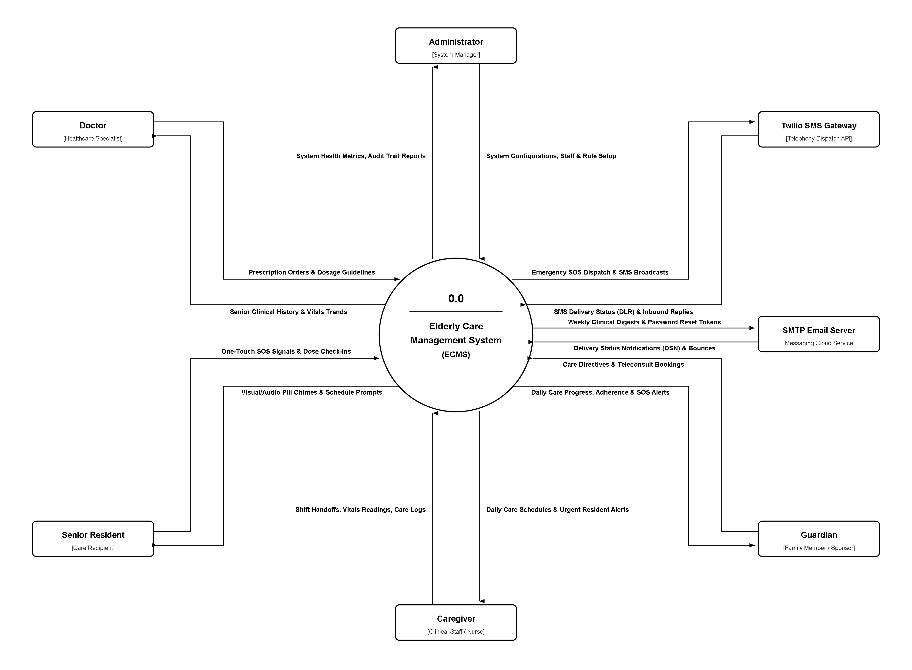

# Elderly Care Management System (ECMS)
## Software Requirements Specification
**Version:** Version 1.0 (Final Release)  
**Status:** Approved  
**Prepared by:** Farzana Sadia Takee (Lead System Analyst & Full-Stack Developer, Student ID: 2211175)  
**Course:** CSE309 - Web Programming (Section: 02, Autumn 2025)  
**Supervised by:** Md Abu Sayed, Senior Lecturer, Department of Computer Science & Engineering  
**Organization:** Independent University, Bangladesh (IUB)  
**Date:** October 18, 2025  

---

## Table of Contents

- 1. Introduction
-    1.1 Purpose
-    1.2 Document Conventions
-    1.3 Intended Audience and Reading Suggestions
-    1.4 Product Scope
-    1.5 References
- 2. Overall Description
-    2.1 Product Perspective
-    2.2 Product Functions
-    2.3 User Classes and Characteristics
-    2.4 Operating Environment
-    2.5 Design and Implementation Constraints
-    2.6 User Documentation
-    2.7 Assumptions and Dependencies
- 3. External Interface Requirements
-    3.1 User Interfaces
-    3.2 Hardware Interfaces
-    3.3 Software Interfaces
-    3.4 Communications Interfaces
- 4. Domain Model
- 5. System Features (Use Cases)
-    5.1 Use Case UC-01: User Authentication & Role-Based Access Control
-    5.2 Use Case UC-02: Senior Resident Profile & Health Record Setup
-    5.3 Use Case UC-03: Medication Regimen Scheduling & Automated Pill Reminders
-    5.4 Use Case UC-04: Daily Caregiving & Medication Administration Logging
-    5.5 Use Case UC-05: Real-Time Vitals Tracking & Physiological Anomaly Alerting
-    5.6 Use Case UC-06: Doctor Appointment Scheduling & Clinical Teleconsultation Booking
-    5.7 Use Case UC-07: Emergency SOS Alert Dispatch & Incident Escalation Workflow
-    5.8 Use Case UC-08: Caregiver Shift Handoff & Clinical Progress Notes
- 6. Other Nonfunctional Requirements
-    6.1 Performance Requirements
-    6.2 Safety Requirements
-    6.3 Security Requirements
-    6.4 Software Quality Attributes
- 7. Other Requirements
-    7.1 Database Requirements
-    7.2 Internationalization & Localization Requirements
-    7.3 Legal, Regulatory & Data Privacy Requirements
-    7.4 Software Reuse & Architectural Extensibility
- Appendix A: Glossary
- Appendix B: Analysis Models
- Appendix C: Interface Examples
- Appendix D: To Be Determined (TBD) List

---

## Revision History

| Name | Date | Reason For Changes | Version | Date of Approval |
| :--- | :--- | :--- | :--- | :--- |
| Farzana Sadia Takee | September 05, 2025 | Initial Draft of ECMS SRS based on Stakeholder Elicitation | 0.1 | September 10, 2025 |
| Farzana Sadia Takee | September 22, 2025 | Integrated Domain Model, Detailed Use Case Flows, and Exception Tables | 0.5 | September 28, 2025 |
| Farzana Sadia Takee | October 08, 2025 | Added Comprehensive NFRs, External Interfaces, and UI Annotations | 0.9 | October 12, 2025 |
| Farzana Sadia Takee | October 18, 2025 | Final Release for System Verification & CSE309 Academic Evaluation | 1.0 | October 18, 2025 |

---

## 1. Introduction

### 1.1 Purpose
This Software Requirements Specification (SRS) document defines the complete functional and non-functional requirements for Version 1.0 (Final Release) of the **Elderly Care Management System (ECMS)**. This specification establishes a binding contract between project stakeholders—including institutional geriatric administrators, family guardians, caregiving personnel, clinical physicians, and software engineering teams. The scope of this document encompasses all core subsystems: User Authentication & Role-Based Access Control (RBAC), Senior Resident Health Profile Management, Medication Regimen Scheduling & Adherence Tracking, Real-Time Vitals Telemetry & Physiological Anomaly Detection, Doctor Appointment Coordination, Multi-Channel Emergency SOS Alert Escalation, and Caregiver Shift Handoff Documentation.

### 1.2 Document Conventions
This document strictly adheres to the **IEEE Std 830-1998 Recommended Practice for Software Requirements Specifications**. In accordance with academic and institutional submission guidelines:
- **Typography & Aesthetics:** Formatted in strict **Black & White** typography to maximize legibility and ensure professional publication standards without distracting decorative borders or excessive coloration.
- **Requirement Identification:** Requirements are uniquely tagged using standardized alphanumeric prefixes (e.g., `UC-XX` for Use Cases, `BR-XX` for Business Rules, `NFR-XX` for Non-Functional Requirements, and `DR-XX` for Data Requirements).
- **Priority Classifications:** System features are classified according to MoSCoW prioritization (Must Have, Should Have, Could Have, and Won't Have for this release).

### 1.3 Intended Audience and Reading Suggestions
This document addresses five primary stakeholder categories, each requiring specific perspectives when reviewing the specification:

| ID | Stakeholder | Description |
| :--- | :--- | :--- |
| S-1 | Family Guardian | Checking correspondence of family oversight goals, resident health transparency, automated SMS notification requirements, and digital billing transparency. |
| S-2 | Development Team | Forming the accurate architectural vision of the project, implementing frontend responsive interfaces, backend PHP endpoints, database schemas, and business rules without ambiguity. |
| S-3 | QA / Testing Team | Formulating test plans, automated verification scripts, boundary exception test suites, and compliance audits against WCAG 2.1 AA accessibility standards. |
| S-4 | Project Manager / BA | Estimating development velocity, planning sprint resource allocations, tracking requirements traceability matrices, and managing delivery timelines. |
| S-5 | Caregivers & Physicians | Validating operational clinical workflows, medication administration protocols, vital sign alert thresholds, and shift handover procedures. |

**Suggested Reading Sequence:**
1. **Executive Stakeholders & Guardians:** Review Section 1 (Introduction), Section 2 (Overall Description), and Appendix C (Interface Examples).
2. **Engineering & Development Team:** Proceed systematically through Section 2 (System Architecture), Section 3 (External Interfaces), Section 4 (Domain Model), Section 5 (Detailed Use Cases), and Appendix B (Analysis Models).
3. **QA & Validation Engineers:** Focus intensely on Section 5 (Use Case basic/alternate flows and Screen Entry Exception Tables) and Section 6 (Non-Functional Requirements).

### 1.4 Product Scope
The Elderly Care Management System (ECMS) is a dedicated healthcare coordination web application engineered to address the critical challenges of geriatric care: uncoordinated paper logs, dangerous medication omissions, delayed emergency responses, and lack of family oversight. ECMS unifies daily caregiving into a centralized, transparent digital ecosystem. Key objectives include:
- Eliminating medication administration errors through scheduled dose reminders and mandatory caregiver verification.
- Providing instant multi-channel emergency SOS alerting with audible sirens, SMS broadcasts, and GPS positioning.
- Enabling real-time physiological telemetry monitoring with automatic anomaly detection for hypertensive crisis or hypoxia.
- Establishing comprehensive clinical continuity across nursing shifts via structured electronic progress notes.
- Delivering an accessible, high-contrast user interface tailored specifically to the visual and motor capabilities of elderly seniors (WCAG 2.1 AA compliant).

### 1.5 References
1. IEEE Computer Society, *IEEE Std 830-1998: IEEE Recommended Practice for Software Requirements Specifications*, IEEE, New York, 1998.
2. World Wide Web Consortium (W3C), *Web Content Accessibility Guidelines (WCAG) 2.1*, W3C Recommendation, 2018.
3. World Health Organization (WHO), *Integrated Care for Older People (ICOPE): Guidance for Person-Centred Assessment and Pathways in Primary Care*, WHO, Geneva, 2019.
4. Health Level Seven International, *HL7 FHIR Release 4.0.1: Fast Healthcare Interoperability Resources*, HL7, 2019.
5. PHP Group, *PHP 8.2 Documentation & Secure PDO Guidelines*, 2024.
6. Twilio Inc., *Twilio REST API Documentation for Programmable SMS & Voice*, 2024.

---

## 2. Overall Description

### 2.1 Product Perspective
The Elderly Care Management System (ECMS) is a newly designed, self-contained web platform developed as an integrated solution for institutional care homes and assisted home care environments. It replaces fragmented, error-prone manual paper charts, unencrypted messaging groups, and uncoordinated telephone calls. ECMS operates as a centralized web application built on the LAMP (Linux, Apache, MySQL, PHP) architecture, integrating with external telecommunication SMS gateways, browser Web Audio APIs, and geolocation mapping services.

The system is architected into three distinct functional tiers:
1. **Presentation Tier:** Responsive HTML5/CSS3/JavaScript frontend tailored with accessible WCAG 2.1 AA standards, large touch controls, and high-contrast visuals.
2. **Application Logic Tier:** Modular PHP backend implementing MVC patterns, authentication middleware, business rule validators, and REST API controllers.
3. **Persistence Tier:** Relational MySQL 8.0 database engine operating in 3rd Normal Form (3NF) with InnoDB ACID transactions, foreign key constraints, and encrypted medical records.

### 2.2 Product Functions
The major functional capabilities provided by the Elderly Care Management System comprise:
- **Resident Profile & Clinical History:** Centralized management of senior demographics, blood groups, chronic ailments, drug allergies, and primary emergency contacts.
- **Medication Administration Record (MAR):** Prescribing, recurring daily scheduling, automated visual/audio alarms, and timestamped caregiver administration logging (Given, Missed, Refused).
- **Vitals Telemetry & Anomaly Alerting:** Tracking Blood Pressure, Pulse, Blood Oxygen (SpO2), Temperature, and Blood Glucose, with automatic anomaly detection triggers.
- **Doctor Appointment & Teleconsultation Scheduling:** Calendar slot reservations, concurrency lock management, and automated SMS clinical reminders.
- **Emergency SOS Incident Management:** One-touch distress trigger with a 5-second false-alarm countdown, automated multi-channel siren broadcast, SMS dispatch, and incident audit tracking.
- **Caregiver Shift Handoff:** Structured electronic handoff notes compiling completed care tasks, overdue items, and clinical progress notes between duty shifts.

### 2.3 User Classes and Characteristics
The system supports five distinct user classes with varying privileges and operational technical proficiencies:

| ID | User Class | Description |
| :--- | :--- | :--- |
| U-1 | System Administrator | A technical superuser who manages system configurations, user account lifecycles, role-based access permissions, audit trail integrity, and automated database backups. |
| U-2 | Family Guardian | A registered family sponsor who onboards elderly residents, manages medical records, monitors daily care logs, receives emergency notifications, and manages financial billing. |
| U-3 | Professional Caregiver / Nurse | A certified clinical staff member who logs daily vitals telemetry, records medication administration adherence, tracks ADLs, and logs shift handoff notes. |
| U-4 | Consulting Physician / Doctor | A licensed medical practitioner who reviews longitudinal health records, prescribes medication schedules, establishes vital threshold alert boundaries, and conducts teleconsultations. |
| U-5 | Elderly Senior Resident | The primary care recipient who utilizes a simplified, high-contrast, large-button interface to view daily schedules, receive pill alarms, and trigger one-touch emergency SOS alerts. |

### 2.4 Operating Environment
ECMS is designed to operate seamlessly across the following technological environment:
- **Client Hardware:** Standard desktop/laptop personal computers, tablets (Apple iPad, Samsung Galaxy Tab with minimum 1024x768 resolution), and smartphones (iOS 14+, Android 10+).
- **Client Browsers:** Modern evergreen web browsers supporting HTML5, CSS Grid, ES6 JavaScript, Web Audio API, and TLS 1.3 (Google Chrome 110+, Mozilla Firefox 110+, Apple Safari 16+, Microsoft Edge 110+).
- **Server Environment:** Apache HTTP Server 2.4+ / Nginx on Ubuntu Linux 22.04 LTS / Windows Server, running PHP 8.2+ with PDO, OpenSSL, and cURL extensions.
- **Database Server:** MySQL Community Server 8.0+ or MariaDB 10.6+ utilizing the InnoDB storage engine with UTF-8 (`utf8mb4`) character collation.
- **Network Connectivity:** Minimum 3G mobile data or broadband connection (bandwidth >= 1.0 Mbps; latency < 150ms).

### 2.5 Design and Implementation Constraints
1. **Accessibility Standards (WCAG 2.1 AA):** The user interface for senior residents must feature a minimum font size of 16px (18px recommended for key labels), a contrast ratio of at least 4.5:1 for normal text and 3:1 for large graphical components, and touch target sizes of at least 44x44 CSS pixels.
2. **Core Technology Stack:** In strict accordance with course and architectural requirements, the core web application must be developed using native HTML5, Vanilla CSS3, JavaScript, PHP, and MySQL without proprietary framework lock-ins.
3. **Security Standards:** All database interactions must use PHP Data Objects (PDO) with parameterized prepared statements to eliminate SQL injection vulnerabilities. All passwords must be salted and hashed via Bcrypt (cost factor >= 12).
4. **Responsive Layouts:** Interfaces must dynamically adapt across viewport widths from 360px (mobile) to 1920px (desktop) without loss of functionality or horizontal scrollbars.

### 2.6 User Documentation
The project deliverables include comprehensive user documentation:
- **Caregiver Quick-Start Operational Card (PDF):** A laminated 2-page pocket guide detailing vitals logging, dose administration, and shift handoff workflows.
- **Senior Resident Visual Guide:** A simplified visual booklet with large iconography explaining how to review daily schedules and trigger/cancel emergency SOS alerts.
- **Administrator Deployment & Maintenance Guide:** Technical documentation covering LAMP installation, cron setup, database backups, and security configurations.

### 2.7 Assumptions and Dependencies
- **Assumptions:** Users have access to compatible browser devices and basic internet connectivity. Caregivers possess basic literacy in operating mobile touch devices. Guardians provide accurate clinical baseline data during resident onboarding.
- **Dependencies:** Continuous uptime of external telecommunications SMS gateways (Twilio API) for emergency dispatch; continuous operation of local SMTP mail servers; and browser permission access to device Geolocation and Web Audio subsystems.

---

## 3. External Interface Requirements

### 3.1 User Interfaces
The user interface of ECMS is built on a card-based visual design pattern emphasizing clarity, high contrast, and rapid touch navigation. Key UI standards include:
- **Consistent Header & Navigation:** Displays the logged-in user profile, active senior resident selector, persistent SOS trigger, and role-appropriate navigational links.
- **Status Indication Badges:** Distinct high-contrast badges for clinical metrics (Normal: `#10B981` green, Warning: `#F59E0B` amber, Critical Anomaly: `#EF4444` red).
- **Modal Windows:** Destructive and life-critical actions (e.g., medication omission, appointment cancellation, SOS triggering) require explicit confirmation dialogs with clear 'Confirm' and 'Cancel' buttons.
- **Senior-Optimized Interface:** Senior dashboards eliminate nested menus, presenting single-tap cards for 'Today's Medicine', 'My Doctor', and a prominent 80px high 'EMERGENCY SOS' button.

### 3.2 Hardware Interfaces
- **Touchscreen Tablets & Smartphones:** Responsive capacitive touch support for tap, long-press (2-second SOS hold), and scroll gestures.
- **Audio Output Hardware:** Interfaces with device sound cards and internal speakers via the Web Audio API to produce an 85+ dB emergency warning siren during distress escalation.
- **GPS Telemetry Receivers:** Interfaces with hardware GPS sensors via the HTML5 Geolocation API to harvest coordinates during emergency SOS dispatches.

### 3.3 Software Interfaces
- **Database Engine (MySQL 8.0):** Communicates via TCP/IP on port 3306 using PHP PDO with strict transaction isolation (READ COMMITTED).
- **Twilio REST SMS Gateway:** Communicates over outbound HTTPS POST requests with JSON payloads to send urgent SMS alerts to mobile telephone networks.
- **Leaflet.js / OpenStreetMap Service:** Interfaces with open-source tile servers over HTTPS to render interactive emergency incident location pins.
- **Web Audio API:** Standard W3C browser audio engine generating multi-frequency synthesized siren tones locally on client devices without requiring external audio file downloads.

### 3.4 Communications Interfaces
- **HTTPS / TLS 1.3:** All web traffic between client browsers and the ECMS web server must be encrypted using Transport Layer Security (TLS 1.3) with modern cipher suites.
- **RESTful JSON Protocol:** Asynchronous data communications (AJAX) utilize standard HTTP methods (GET, POST, PUT, DELETE) with `application/json` content-type headers.
- **SMTP / TLS:** Outbound email summaries and appointment reminders are routed through standard SMTP over port 587 with STARTTLS encryption.

---

## 4. Domain Model

The domain model defines the core conceptual entities, their attributes, operations, and interrelationships within the geriatric care management domain. The central entity is the **Senior Resident**, whose care ecosystem is supported by family guardians, clinical caregivers, and attending physicians.

### Core Domain Entities:
1. **User:** Base actor entity encapsulating `user_id`, `email`, `password_hash`, `role` (Admin, Guardian, Caregiver, Doctor, Senior), `phone`, `status`, and `created_at`.
2. **Senior:** Represents the care recipient, capturing `senior_id`, `mrn_number`, `full_name`, `dob`, `gender`, `blood_group`, `allergies`, `chronic_conditions`, `room_number`, and `guardian_id`.
3. **Medication:** Master pharmaceutical drug definition containing `med_id`, `generic_name`, `brand_name`, `dosage_form`, `strength`, and `contraindications`.
4. **MedicationSchedule:** Recurring regimen entry storing `schedule_id`, `senior_id`, `med_id`, `frequency`, `scheduled_time`, `meal_relation`, `start_date`, and `end_date`.
5. **MedicationLog:** Permanent administration record tracking `log_id`, `schedule_id`, `administered_at`, `status` (Given, Missed, Refused), `reason`, `caregiver_id`, and `signature_pin`.
6. **VitalSign:** Longitudinal physiological telemetry storing `vital_id`, `senior_id`, `recorded_at`, `systolic_bp`, `diastolic_bp`, `pulse_rate`, `spo2`, `temperature`, `glucose`, `caregiver_id`, and `is_anomaly`.
7. **Appointment:** Medical consultation booking containing `appointment_id`, `senior_id`, `doctor_id`, `scheduled_at`, `consultation_type` (In-Person, Teleconsult), `status`, and `notes`.
8. **EmergencyAlert:** Incident management record tracking `alert_id`, `senior_id`, `triggered_at`, `trigger_source`, `latitude`, `longitude`, `status` (Triggered, Responding, Resolved), and `resolved_by`.
9. **ShiftNote:** Shift handover continuity report tracking `shift_id`, `caregiver_id`, `shift_type`, `handover_to`, `progress_notes`, `overdue_tasks`, and `signed_at`.
10. **AuditTrail:** Immutable security record capturing `audit_id`, `user_id`, `action`, `entity_affected`, `ip_address`, and `timestamp`.

*(Refer to Appendix B for the comprehensive Entity-Relationship Diagram detailing primary keys, foreign key constraints, and 1:N cardinalities.)*

---

## 5. System Features (Use Cases)

This section documents the eight (8) core system features of ECMS in exhaustive, structured IEEE Std 830 use case specifications. Each use case details operational triggers, preconditions, paired basic flows, alternate flows, sub-flows, business rules, non-functional constraints, and screen entry exception tables.

### 5.1 Use Case UC-01: User Authentication & Role-Based Access Control (RBAC)

**Brief Description:** Enables registered system actors (Administrators, Guardians, Caregivers, Doctors, and Seniors) to securely authenticate using their verified credentials. The system validates the session and grants access strictly to authorized role-specific dashboards.

**Business Trigger:** A user accesses the ECMS login portal or attempts to request an internal protected route.

**Preconditions:** The user must possess an active, non-suspended account in the system database with configured role permissions.

**Basic Flow:**  
*Assumptions: The client browser supports modern cookies, JavaScript, and TLS 1.3 encryption.*

| Line | System Actor Action | System Response |
| :--- | :--- | :--- |
| 1 | The user navigates to the ECMS secure login portal and enters their registered email address and password. | The system validates client-side input formatting and renders an active login submission state. |
| 2 | The user clicks the 'Secure Login' button to transmit credentials. | The system computes the Bcrypt verification hash against the stored credentials in the users database table. |
| 3 | The system verifies matching credentials and retrieves the actor's role attribute (Admin, Guardian, Caregiver, Doctor, Senior). | The system generates a cryptographically secure 256-bit session token, sets an HTTP-only secure cookie, and initializes the role permission matrix. |
| 4 | The system audits the successful login event with client IP and timestamp. | The system redirects the authenticated actor directly to their designated role dashboard. |

**Post Condition:** The user is authenticated, an active encrypted session is maintained, and role-appropriate navigational menus are loaded.

#### Alternate Flow (AF1: Invalid Credentials Entered)
*If at line 2 in Basic Flow the email does not exist or the password hash fails verification, then:*

| Line | System Actor Action | System Response |
| :--- | :--- | :--- |
| 1 | The user submits unverified or mismatched credentials. | The system increments the failed login attempt counter for the given username and IP address. |
| 2 | The user observes an error notification: 'Invalid email or password combination. Please try again.' | The system resets the password field while preserving the email field, logging the security event. |

*The use case restarts at line 1 in Basic Flow.*  
**Post Condition:** No session is created, the system remains locked, and the failed attempt is recorded.

#### Alternate Flow (AF2: Account Lockout after Excessive Failures)
*If at line 2 in Basic Flow the failed login counter reaches five (5) consecutive unsuccessful attempts within 15 minutes, then:*

| Line | System Actor Action | System Response |
| :--- | :--- | :--- |
| 1 | The user submits a fifth consecutive erroneous credential pair. | The system flags the account as temporarily locked for a 15-minute cooldown period. |
| 2 | The user receives a high-priority warning modal: 'Account locked due to multiple failed login attempts. Try again in 15 minutes or contact Administrator.' | The system dispatches an automated security notification email to the account's registered address and disables login form submissions. |

*The use case terminates.*  
**Post Condition:** Account login is temporarily disabled, and an administrative security incident is logged.

#### Sub-Flow: SF1: Two-Factor Authentication (2FA) Verification

| Line | System Actor Action | System Response |
| :--- | :--- | :--- |
| 1 | For Administrator and Doctor roles, the system generates a 6-digit one-time verification passcode (OTP) and sends it via SMS/email. | The system displays a modal requesting the time-sensitive 6-digit OTP code. |
| 2 | The actor inputs the 6-digit OTP code and clicks 'Verify Passcode'. | The system validates the token against the active session hash within the 5-minute validity window. |

*Return to Basic Flow line 3.*

#### Business Rules:
- BR-01: Passwords must contain a minimum of 8 characters, including at least one uppercase letter, one digit, and one special character.
- BR-02: Passwords must be hashed using Bcrypt with a minimum cost factor of 12 prior to database persistence.
- BR-03: Inactive authenticated sessions must automatically terminate after 15 minutes of user inactivity.
- BR-04: Role escalation is strictly prohibited; users can only access endpoints authorized by their primary role.

#### Non-Functional Requirements:
- NFR-01: Credential verification and dashboard redirection must complete within 800 milliseconds under standard network conditions.
- NFR-02: Authentication endpoints must be protected against brute-force attacks via IP-based rate limiting (maximum 10 requests per minute).

#### Data Requirements:
- DR-01: User email string (RFC 5322 compliant, max 100 characters).
- DR-02: User password string (UTF-8, minimum 8 characters, max 72 characters for Bcrypt hashing).
- DR-03: Session token (256-bit cryptographically secure pseudorandom string stored in HTTP-only, SameSite=Strict cookie).

#### Screen Entry Exception Table:

| Field | Constraint | Response |
| :--- | :--- | :--- |
| Email Address | Must be a valid RFC 5322 email format | Message: 'Invalid email format – please enter a valid address' |
| Password | Length must be between 8 and 72 characters | Message: 'Password must be at least 8 characters with 1 digit and 1 special symbol' |
| Account Status | Account must be in 'Active' state | Message: 'Account is deactivated – please contact system administrator' |

---

### 5.2 Use Case UC-02: Senior Resident Profile & Health Record Setup

**Brief Description:** Allows Family Guardians or System Administrators to register a new elderly resident into the ECMS repository, documenting demographic details, baseline vital norms, chronic diagnoses, dietary restrictions, mobility status, and emergency contacts.

**Business Trigger:** A family guardian registers an elderly relative for home or institutional geriatric care coordination.

**Preconditions:** The actor is logged in with an active Guardian or Administrator role.

**Basic Flow:**  
*Assumptions: The guardian has accurate clinical history, National ID/birth registration, and attending physician details available.*

| Line | System Actor Action | System Response |
| :--- | :--- | :--- |
| 1 | The guardian clicks 'Add New Senior Resident' on the Guardian Management portal. | The system renders the multi-step resident onboarding form with demographic, clinical, and emergency contact tabs. |
| 2 | The guardian enters full legal name, date of birth, blood group, gender, emergency contact phone, and residential room/bed assignment. | The system performs real-time field validation, verifying date formatting and phone number syntax. |
| 3 | The guardian enters known chronic conditions (e.g., Hypertension, Type-2 Diabetes, Dementia) and drug allergies. | The system checks the entered allergies against the national drug formulary allergy registry. |
| 4 | The guardian submits the completed resident profile. | The system assigns a unique Medical Record Number (MRN), stores the record in the seniors table, and triggers an onboarding confirmation. |

**Post Condition:** A new senior resident profile is persisted in the database, linked to the guardian, and accessible by assigned caregivers.

#### Alternate Flow (AF1: Duplicate Senior Registration Detected)
*If at line 2 in Basic Flow the senior's National ID or full name and birth date match an existing active resident, then:*

| Line | System Actor Action | System Response |
| :--- | :--- | :--- |
| 1 | The guardian inputs details of an already registered individual. | The system queries the seniors table and detects an identical NID/name conflict. |
| 2 | The system displays an alert modal: 'A senior resident with this National ID already exists in the system.' | The system prompts the user to link their guardian account to the existing profile or contact support. |

*The use case terminates or redirects to Guardian Linkage Request.*  
**Post Condition:** Duplicate resident records are prevented, ensuring database entity uniqueness.

#### Sub-Flow: SF1: Emergency Contact Verification

| Line | System Actor Action | System Response |
| :--- | :--- | :--- |
| 1 | The guardian enters primary and secondary emergency contact phone numbers. | The system sends an automated SMS confirmation token to verify primary emergency contact reachability. |
| 2 | The guardian confirms the received token on the interface. | The system marks the emergency contact as 'Verified'. |

*Return to Basic Flow line 4.*

#### Business Rules:
- BR-05: Every senior resident must have at least one verified primary emergency contact number.
- BR-06: Senior age must be at least 60 years old at the time of registration, or marked with a special geriatric dispensation flag.
- BR-07: Drug allergy tags are mandatory; if no allergies exist, the actor must explicitly check 'No Known Drug Allergies (NKDA)'.

#### Non-Functional Requirements:
- NFR-03: Resident registration and MRN assignment must complete within 1.0 second.
- NFR-04: Senior health records must be encrypted at rest using AES-256.

#### Data Requirements:
- DR-04: Senior Full Legal Name (1-100 characters).
- DR-05: Date of Birth (YYYY-MM-DD, age >= 60).
- DR-06: Blood Group (Enum: A+, A-, B+, B-, AB+, AB-, O+, O-).
- DR-07: Emergency Contact Phone (E.164 international format, e.g., +88017XXXXXXXX).

#### Screen Entry Exception Table:

| Field | Constraint | Response |
| :--- | :--- | :--- |
| Senior Full Name | Max 100 characters, alphabetic characters only | Message: 'Invalid name – letters and spaces only' |
| Date of Birth | Must represent an age of 60 or greater | Message: 'Senior resident must be at least 60 years of age' |
| Emergency Phone | Valid Bangladeshi or international phone number | Message: 'Invalid phone number format – please enter valid 11-digit mobile number' |

---

### 5.3 Use Case UC-03: Medication Regimen Scheduling & Automated Pill Reminders

**Brief Description:** Enables Consulting Physicians or Family Guardians to schedule recurring drug prescriptions, dosages, administration routes, meal associations, and daily timings. The system schedules automated audio and SMS alerts.

**Business Trigger:** A doctor issues a new prescription or a guardian updates an ongoing chronic medication schedule.

**Preconditions:** The senior resident profile exists and the prescribing doctor or guardian is authenticated.

**Basic Flow:**  
*Assumptions: Medication names are matched against standard pharmaceutical generic nomenclatures.*

| Line | System Actor Action | System Response |
| :--- | :--- | :--- |
| 1 | The physician selects a senior resident and navigates to the 'Medication Schedule' tab. | The system displays active medications, dosage calendars, and a 'Prescribe New Medication' action. |
| 2 | The physician enters medication name, dosage strength (e.g., 5mg, 500mg), form (Tablet, Syrup, Injection), and route. | The system searches the pharmaceutical database to autocomplete generic drug names. |
| 3 | The physician specifies frequency (Once daily, Twice daily, Every 8 hours) and meal timing (Before Meal, After Meal). | The system computes daily administration schedule times (e.g., 08:00 AM, 08:00 PM). |
| 4 | The physician sets regimen start date, end date, and any special instructions. | The system validates dosage ranges against geriatric safety thresholds and checks for drug-drug interactions. |
| 5 | The physician clicks 'Save & Activate Regimen'. | The system creates scheduled slots in the medication_schedules table and initializes automated reminder cron triggers. |

**Post Condition:** A new medication regimen is active, and daily reminder timers are queued for caregiver and senior interfaces.

#### Alternate Flow (AF1: Severe Drug-Drug Interaction Detected)
*If at line 4 in Basic Flow the newly prescribed drug has a known contraindication with an existing active medication, then:*

| Line | System Actor Action | System Response |
| :--- | :--- | :--- |
| 1 | The physician attempts to save a conflicting drug regimen (e.g., Warfarin + Aspirin). | The clinical interaction engine identifies a Level-1 severe bleeding hazard. |
| 2 | The system displays a prominent modal alert detailing the clinical interaction hazard. | The physician is required to either cancel the entry or enter a clinical justification override code. |

*The use case restarts at line 2 in Basic Flow if canceled, or proceeds to line 5 upon authorized override.*  
**Post Condition:** Contraindicated drug combinations are prevented or audited with physician rationale.

#### Sub-Flow: SF1: Automated Reminder Notification Dispatch

| Line | System Actor Action | System Response |
| :--- | :--- | :--- |
| 1 | The background cron trigger detects a scheduled dosage window within 15 minutes. | The system pushes a visual pill card notification to the caregiver's dashboard and plays a gentle audio chime on the senior's tablet. |
| 2 | If unacknowledged within 10 minutes past the due time, the system dispatches an SMS reminder. | The system logs the reminder dispatch event. |

*Return to main scheduling flow.*

#### Business Rules:
- BR-08: Only verified Physicians or authorized Guardians can create or modify medication schedules.
- BR-09: End dates cannot precede start dates; ongoing chronic medications must be flagged with 'Indefinite' status.
- BR-10: Medication reminder notifications must fire exactly 15 minutes before and at the exact scheduled dosage timestamp.

#### Non-Functional Requirements:
- NFR-05: Drug interaction checks must evaluate against the local clinical database within 300 milliseconds.
- NFR-06: Scheduled reminder notifications must dispatch with 99.9% on-time accuracy.

#### Data Requirements:
- DR-08: Medication Name (String, max 100 chars).
- DR-09: Dosage Amount and Unit (e.g., '500 mg', '10 ml', '1 drop').
- DR-10: Administration Times (Array of HH:MM strings).
- DR-11: Meal Association (Enum: 'Before Meal', 'After Meal', 'With Food', 'Empty Stomach').

#### Screen Entry Exception Table:

| Field | Constraint | Response |
| :--- | :--- | :--- |
| Medication Name | Mandatory text field, max 100 characters | Message: 'Medication name cannot be empty' |
| Dosage Strength | Positive numeric value with valid unit | Message: 'Please enter a valid numeric dosage and unit' |
| Start Date | Must be equal to or greater than today's date | Message: 'Start date cannot be in the past' |

---

### 5.4 Use Case UC-04: Daily Caregiving & Medication Administration Logging

**Brief Description:** Enables the assigned Duty Caregiver or Nurse to record real-time medication intake status (Given, Missed, Refused) for scheduled doses, recording time of administration, caregiver PIN, and clinical observations.

**Business Trigger:** The scheduled medication administration time arrives, or a caregiver physically administers medication to a senior resident.

**Preconditions:** The caregiver is authenticated, and a scheduled medication slot exists for the senior resident.

**Basic Flow:**  
*Assumptions: The caregiver is physically co-located with the resident or confirming home care administration.*

| Line | System Actor Action | System Response |
| :--- | :--- | :--- |
| 1 | The caregiver opens the 'Daily MAR (Medication Administration Record)' dashboard. | The system displays a chronologically sorted list of pending, due, and completed medications for the resident. |
| 2 | The caregiver locates the due dose and clicks the 'Administer' button. | The system displays the medication confirmation modal with resident photo, drug name, dosage, and meal instructions. |
| 3 | The caregiver physically administers the dose and selects the status 'Given'. | The system captures current timestamp and auto-populates administering caregiver credentials. |
| 4 | The caregiver enters optional observation notes and enters their 4-digit verification PIN. | The system validates the caregiver PIN, stores the log in medication_logs, updates schedule state to 'Administered', and sends a real-time sync event to the Guardian portal. |

**Post Condition:** The dose is permanently marked as 'Given' with full timestamped auditability.

#### Alternate Flow (AF1: Resident Refuses Medication)
*If at line 3 in Basic Flow the senior resident refuses to take the prescribed medication, then:*

| Line | System Actor Action | System Response |
| :--- | :--- | :--- |
| 1 | The caregiver selects status 'Refused' on the confirmation modal. | The system mandates entry of a clinical refusal reason (e.g., Nausea, Agitation, Discomfort). |
| 2 | The caregiver inputs the refusal explanation and submits. | The system records the omission, flags the dose in amber/red on the dashboard, and queues an instant alert to the Guardian and Doctor. |

*The use case terminates.*  
**Post Condition:** Dose is recorded as 'Refused', preventing duplicate administration while notifying supervisors.

#### Alternate Flow (AF2: Dose Missed Due to Resident Sleep or Absence)
*If at line 3 in Basic Flow the dose is not administered within 60 minutes of scheduled time, then:*

| Line | System Actor Action | System Response |
| :--- | :--- | :--- |
| 1 | The system's automated adherence cron detects an overdue slot. | The system marks the slot as 'Missed'. |
| 2 | The system displays an overdue warning to the duty caregiver. | The caregiver is prompted to either log late administration with justification or confirm omission. |

*The use case restarts at line 2 in Basic Flow if late administration is approved.*  
**Post Condition:** The adherence record reflects accurate clinical reality.

#### Sub-Flow: SF1: Guardian Immediate Notification Dispatch

| Line | System Actor Action | System Response |
| :--- | :--- | :--- |
| 1 | The system triggers a background web-hook upon status change to 'Refused' or 'Missed'. | The notification service sends an SMS alert to the registered Guardian phone number. |
| 2 | The system writes the dispatch status to the notification_logs table. | The alert is displayed on the Guardian's live feed. |

*Return to Basic Flow line 4.*

#### Business Rules:
- BR-11: A medication record entry cannot be deleted or retroactively altered once submitted; corrections require a supplementary addendum note.
- BR-12: If status is 'Refused' or 'Missed', the reason field is mandatory and must contain at least 10 characters.
- BR-13: Caregiver PIN is mandatory for non-repudiation of medication administration.

#### Non-Functional Requirements:
- NFR-07: Dose logging submission must be committed to the database within 400 milliseconds.
- NFR-08: The MAR interface must render on mobile tablets without horizontal scrolling.

#### Data Requirements:
- DR-12: Administration Status (Enum: 'Given', 'Missed', 'Refused').
- DR-13: Actual Administration Timestamp (Datetime YYYY-MM-DD HH:MM:SS).
- DR-14: Caregiver Verification PIN (4-digit numeric string).
- DR-15: Clinical Observation Notes (Text, max 500 characters).

#### Screen Entry Exception Table:

| Field | Constraint | Response |
| :--- | :--- | :--- |
| Status Reason | Mandatory if status is not 'Given', min 10 chars | Message: 'Please provide a clinical explanation for missed or refused medication' |
| Caregiver PIN | Must match the 4-digit PIN of the logged-in caregiver | Message: 'Incorrect verification PIN – entry rejected' |
| Timestamp | Cannot be set in the future | Message: 'Administration timestamp cannot exceed current system time' |

---

### 5.5 Use Case UC-05: Real-Time Vitals Tracking & Physiological Anomaly Alerting

**Brief Description:** Enables Caregivers to log physiological vital signs (Blood Pressure, Heart Rate, SpO2, Temperature, Blood Glucose) and allows the system to automatically detect critical abnormal thresholds and trigger escalation sirens.

**Business Trigger:** A caregiver conducts a scheduled morning/evening vitals check, or a resident reports acute physical discomfort.

**Preconditions:** The caregiver is authenticated, and baseline physiological thresholds are defined for the resident.

**Basic Flow:**  
*Assumptions: Vitals are measured using calibrated clinical diagnostic instruments (e.g., digital cuff, pulse oximeter).*

| Line | System Actor Action | System Response |
| :--- | :--- | :--- |
| 1 | The caregiver selects the senior resident and clicks 'Record New Vitals'. | The system renders the vitals entry form with fields for Systolic/Diastolic BP, Heart Rate, SpO2, Temperature, and Blood Glucose. |
| 2 | The caregiver inputs measured values (e.g., BP: 120/80 mmHg, Pulse: 72 bpm, SpO2: 98%, Temp: 98.6°F). | The system performs real-time client-side range validation and displays immediate color-coded indicator badges (Green: Normal). |
| 3 | The caregiver adds contextual observations (e.g., 'Resident resting comfortably after breakfast'). | The system computes the composite Early Warning Score (EWS) for the resident. |
| 4 | The caregiver clicks 'Save Vitals Record'. | The system stores values in the vitals table, updates longitudinal trend graphs, and displays a success notification. |

**Post Condition:** Vitals are recorded, trend charts are updated, and health status remains in 'Stable' condition.

#### Alternate Flow (AF1: Critical Vital Anomaly Detected (Hypertensive Crisis / Hypoxia))
*If at line 2 in Basic Flow any vital sign exceeds defined critical thresholds (e.g., Systolic BP > 180, SpO2 < 90%, Pulse > 120 bpm), then:*

| Line | System Actor Action | System Response |
| :--- | :--- | :--- |
| 1 | The caregiver enters an abnormal reading (e.g., SpO2 = 87%, BP = 190/110 mmHg). | The system immediately flashes a high-contrast Red Alert banner on the screen and sounds an emergency audio alert chime. |
| 2 | The system prompts the caregiver to immediately re-verify the reading and confirm patient positioning. | The system dispatches an automated high-priority SMS alert to the attending Physician and Family Guardian with exact readings. |
| 3 | The caregiver confirms the reading and selects 'Dispatch Emergency Response' if necessary. | The system escalates the incident to the Emergency SOS dispatch queue. |

*The use case proceeds to line 4 with an 'Anomaly Flag' active.*  
**Post Condition:** Vitals are saved with an urgent clinical escalation flag, alerting guardians and physicians.

#### Sub-Flow: SF1: Longitudinal Trend Analysis Rendering

| Line | System Actor Action | System Response |
| :--- | :--- | :--- |
| 1 | Upon saving new vitals, the system queries the previous 30 days of telemetry. | The system calculates 7-day moving averages and identifies upward or downward physiological drift. |
| 2 | The system updates the SVG sparkline visualization on the resident's summary card. | The caregiver views the real-time visual trajectory. |

*Return to Basic Flow line 4.*

#### Business Rules:
- BR-14: Standard physiological alert boundaries: Systolic BP > 140 or < 90 mmHg; SpO2 < 92%; Heart Rate > 100 or < 50 bpm; Blood Glucose > 200 or < 70 mg/dL.
- BR-15: Custom doctor-prescribed thresholds override default system boundaries for specific residents (e.g., COPD or chronic hypotension patients).
- BR-16: Critical anomaly alerts must persist on the screen until explicitly acknowledged by a licensed nurse or physician.

#### Non-Functional Requirements:
- NFR-09: Anomaly detection rules must evaluate in less than 150 milliseconds upon form input.
- NFR-10: Critical SMS alert dispatches must be submitted to the telecommunications gateway within 5 seconds.

#### Data Requirements:
- DR-16: Systolic BP (Integer, 50-250 mmHg).
- DR-17: Diastolic BP (Integer, 30-150 mmHg).
- DR-18: Pulse Rate (Integer, 30-220 BPM).
- DR-19: SpO2 Blood Oxygen (Integer, 50-100 %).
- DR-20: Body Temperature (Decimal, 90.0-108.0 °F).

#### Screen Entry Exception Table:

| Field | Constraint | Response |
| :--- | :--- | :--- |
| Systolic BP | Numeric, between 50 and 250 | Message: 'Systolic value out of physiological range (50-250)' |
| SpO2 | Numeric percentage, between 50 and 100 | Message: 'SpO2 must be between 50% and 100%' |
| Temperature | Numeric, between 90.0 and 108.0 °F | Message: 'Temperature out of measurable range (90.0-108.0 °F)' |

---

### 5.6 Use Case UC-06: Doctor Appointment Scheduling & Clinical Teleconsultation Booking

**Brief Description:** Allows Family Guardians or Caregivers to book, reschedule, or cancel clinical medical appointments and teleconsultations with specialized geriatric physicians, managing schedule conflicts and clinical reminders.

**Business Trigger:** A senior resident requires a routine health checkup, specialist review, or follow-up teleconsultation.

**Preconditions:** The user is authenticated, the resident profile is active, and attending doctors have active availability slots.

**Basic Flow:**  
*Assumptions: Doctors maintain updated digital availability schedules in the ECMS provider registry.*

| Line | System Actor Action | System Response |
| :--- | :--- | :--- |
| 1 | The guardian clicks 'Book Medical Appointment' on the resident care portal. | The system displays a directory of registered doctors, specializations (Cardiology, Geriatrics, Neurology), and clinic venues. |
| 2 | The guardian selects a doctor, chooses consultation mode (In-Person Clinic or Teleconsultation), and picks a calendar date. | The system queries the appointments table and renders real-time available 30-minute time slots. |
| 3 | The guardian selects an open time slot and enters the chief clinical complaint / reason for visit. | The system locks the selected slot for 10 minutes to prevent double-booking conflicts. |
| 4 | The guardian confirms the appointment booking. | The system creates the record with status 'Confirmed', generates an iCalendar invite, and dispatches SMS confirmations to the doctor and guardian. |

**Post Condition:** The medical appointment is confirmed, calendar slots are reserved, and reminders are queued.

#### Alternate Flow (AF1: Schedule Conflict / Slot Already Reserved)
*If at line 3 in Basic Flow another user confirms the same time slot simultaneously, then:*

| Line | System Actor Action | System Response |
| :--- | :--- | :--- |
| 1 | The guardian attempts to confirm a slot that was just reserved. | The system detects a concurrency lock conflict on the appointment slot. |
| 2 | The system displays an alert: 'The selected appointment slot has just been booked. Please choose another available time.' | The system refreshes the available slots view with current real-time data. |

*The use case restarts at line 2 in Basic Flow.*  
**Post Condition:** Double-booking is prevented.

#### Alternate Flow (AF2: Appointment Cancellation / Rescheduling)
*If a guardian cancels or reschedules an existing appointment at least 24 hours prior to the slot, then:*

| Line | System Actor Action | System Response |
| :--- | :--- | :--- |
| 1 | The guardian navigates to active appointments and clicks 'Cancel / Reschedule Appointment'. | The system prompts for cancellation reason and confirms user intent. |
| 2 | The guardian inputs the reason and confirms cancellation. | The system releases the time slot back to public availability, sets appointment status to 'Cancelled', and notifies the physician via SMS/email. |

*The use case terminates.*  
**Post Condition:** The slot is freed, and status is updated with cancellation audit logs.

#### Sub-Flow: SF1: Automated 24-Hour Clinical Reminder

| Line | System Actor Action | System Response |
| :--- | :--- | :--- |
| 1 | The background cron worker scans for appointments occurring within 24 hours. | The system compiles appointment details, doctor name, and clinic address / teleconsultation URL. |
| 2 | The system dispatches SMS reminders to the guardian and resident. | The notification timestamp is updated. |

*Return to main scheduling flow.*

#### Business Rules:
- BR-17: In-person and teleconsultation appointment slots must be configured in 30-minute discrete intervals.
- BR-18: Cancellations within 2 hours of scheduled time require administrative override or incur a standard late cancellation flag.
- BR-19: A resident cannot have two overlapping appointments scheduled on the same date and time.

#### Non-Functional Requirements:
- NFR-11: Available slot queries across 30 days of physician schedules must render in under 500 milliseconds.
- NFR-12: The scheduling system must support concurrent bookings without race conditions via database row-level locking.

#### Data Requirements:
- DR-21: Doctor ID (Foreign key linking to doctors table).
- DR-22: Appointment Date & Time (YYYY-MM-DD HH:MM:SS).
- DR-23: Consultation Type (Enum: 'In-Person', 'Teleconsultation').
- DR-24: Chief Complaint / Clinical Notes (Text, max 500 characters).

#### Screen Entry Exception Table:

| Field | Constraint | Response |
| :--- | :--- | :--- |
| Appointment Date | Must be a future date | Message: 'Appointment date must be scheduled for a future day' |
| Chief Complaint | Mandatory text, min 5 chars, max 500 chars | Message: 'Please provide a brief reason for the medical visit' |
| Slot Selection | Must select a valid available slot | Message: 'Please select an available appointment time slot' |

---

### 5.7 Use Case UC-07: Emergency SOS Alert Dispatch & Incident Escalation Workflow

**Brief Description:** Enables an Elderly Senior Resident (via a single prominent screen touch or physical pendant) or Caregiver to trigger an instantaneous high-priority distress alert. The system broadcasts audio sirens, dispatches SMS notifications with GPS coordinates, and escalates to family guardians and emergency response teams.

**Business Trigger:** A senior resident experiences an acute fall, severe chest pain, sudden breathlessness, or a caregiver encounters a medical collapse.

**Preconditions:** The resident profile is active, and verified emergency contacts are registered.

**Basic Flow:**  
*Assumptions: The senior device has network connectivity, or the gateway provides cellular SMS fallback.*

| Line | System Actor Action | System Response |
| :--- | :--- | :--- |
| 1 | The senior resident taps the giant red 'EMERGENCY SOS' button on their visual tablet, or holds it for 2 seconds. | The system displays a prominent 5-second countdown modal with a loud audible chime and 'Cancel if Accidental' option. |
| 2 | The countdown expires without cancellation. | The system initiates the High-Priority Emergency Protocol, capturing current timestamp and GPS coordinates. |
| 3 | The system broadcasts an emergency siren audio alert to all active caregiver dashboards on the local network. | The system simultaneously transmits urgent SMS distress messages to the primary Family Guardian and attending Doctor with resident name, room number, and phone link. |
| 4 | The on-duty caregiver clicks 'Acknowledge Emergency' on their dashboard. | The system changes emergency state to 'Responding', records the caregiver's identity, silences sirens, and displays emergency instructions. |

**Post Condition:** Emergency SOS is logged, responders are notified, and an active incident management record is tracked until resolved.

#### Alternate Flow (AF1: Accidental SOS False Alarm Canceled)
*If at line 1 in Basic Flow the senior resident accidentally presses the SOS button and taps 'Cancel' within the 5-second window, then:*

| Line | System Actor Action | System Response |
| :--- | :--- | :--- |
| 1 | The senior resident taps 'Cancel False Alarm' during the 5-second countdown. | The system halts the emergency dispatch sequence and silences the warning chime. |
| 2 | The system displays a reassuring confirmation: 'Emergency alert canceled. Stay safe!' | The system logs the false alarm event in audit_logs for sensitivity monitoring without alerting external family contacts. |

*The use case terminates.*  
**Post Condition:** No external SMS messages are sent, and normal operation resumes.

#### Alternate Flow (AF2: Unacknowledged SOS Escalation to External 999 Emergency Services)
*If at line 4 in Basic Flow no on-duty caregiver acknowledges the emergency within 180 seconds (3 minutes), then:*

| Line | System Actor Action | System Response |
| :--- | :--- | :--- |
| 1 | The emergency escalation timer exceeds the 3-minute threshold without caregiver acknowledgment. | The system triggers Level-2 Maximum Escalation. |
| 2 | The system dispatches secondary SMS broadcasts to secondary family guardians and the facility chief administrator. | The system displays a prominent one-touch direct dial link to Bangladesh Emergency Services (999) and local hospital ambulances. |

*The use case terminates upon external responder arrival.*  
**Post Condition:** Incident is escalated to maximum severity, ensuring guaranteed life safety response.

#### Sub-Flow: SF1: GPS Geolocation Ingestion

| Line | System Actor Action | System Response |
| :--- | :--- | :--- |
| 1 | The browser or device Geolocation API retrieves current latitude and longitude coordinates. | The system constructs an OpenStreetMap / Google Maps emergency location URL. |
| 2 | The location link is appended directly into the outbound emergency SMS payload. | The recipient can tap the link for turn-by-turn navigation. |

*Return to Basic Flow line 3.*

#### Business Rules:
- BR-20: Emergency SOS dispatches bypass all system throttling, quiet hours, and do-not-disturb filters.
- BR-21: The 5-second cancellation countdown is strictly limited to prevent accidental false alarms while maintaining life-critical speed.
- BR-22: Every SOS incident must remain in 'Active/Responding' state until a verified clinical staff member completes a formal 'Incident Resolution Report'.

#### Non-Functional Requirements:
- NFR-13: The entire SOS dispatch sequence (database creation, audio siren trigger, SMS transmission) must complete in under 3.0 seconds.
- NFR-14: Emergency sirens must emit at maximum system audio volume (utilizing Web Audio API at 85+ dB output).

#### Data Requirements:
- DR-25: Emergency Alert ID (Auto-increment primary key).
- DR-26: Trigger Source (Enum: 'Senior One-Touch', 'Caregiver Manual', 'Vitals Anomaly Auto-Trigger').
- DR-27: Incident Status (Enum: 'Triggered', 'Responding', 'Resolved', 'False Alarm').
- DR-28: GPS Coordinates (Latitude and Longitude decimal strings).

#### Screen Entry Exception Table:

| Field | Constraint | Response |
| :--- | :--- | :--- |
| Network Outage | System loses internet connection during SOS trigger | Message: 'Network disconnected – attempting local cellular SMS dispatch and sounding local siren' |
| GPS Unavailable | Device location permissions denied | Message: 'GPS coordinates unavailable – defaulting to registered resident room/bed address' |
| Resolution Notes | Mandatory min 20 chars to close incident | Message: 'Incident resolution requires detailed clinical documentation' |

---

### 5.8 Use Case UC-08: Caregiver Shift Handoff & Clinical Progress Notes

**Brief Description:** Enables the outgoing duty caregiver to document structured clinical progress notes, summarized care activities, upcoming medication requirements, and special resident behavioral observations for the incoming shift caregiver, ensuring seamless continuity of care.

**Business Trigger:** A caregiver's scheduled duty shift ends (e.g., Morning to Evening shift handoff at 02:00 PM or 10:00 PM).

**Preconditions:** The outgoing caregiver is authenticated and has active care assignments during the shift window.

**Basic Flow:**  
*Assumptions: The incoming shift caregiver is available to review and co-sign the digital handoff summary.*

| Line | System Actor Action | System Response |
| :--- | :--- | :--- |
| 1 | The outgoing caregiver clicks 'Complete Shift Handoff' on the clinical portal. | The system automatically aggregates care events completed during the shift: medications given, vitals checked, ADL logs, and any reported anomalies. |
| 2 | The outgoing caregiver reviews the automated summary and enters narrative clinical progress notes (e.g., resident mood, dietary intake, mobility changes). | The system verifies note completeness and checks for pending unresolved tasks. |
| 3 | The outgoing caregiver tags any high-priority follow-up items for the next shift (e.g., 'Monitor fluid intake; Dr. Rahman visiting at 04:00 PM'). | The system formats the handoff report and prompts for outgoing caregiver signature / PIN. |
| 4 | The outgoing caregiver enters their PIN and submits the handoff report. | The system stores the report in the shift_notes table, transitions shift status, and flags the handoff summary as 'Pending Acknowledgment' for incoming staff. |

**Post Condition:** A structured, permanent shift handoff record is logged, providing complete clinical continuity and legal accountability.

#### Alternate Flow (AF1: Pending Overdue Care Tasks Detected at Shift End)
*If at line 1 in Basic Flow there are unadministered scheduled medications or unrecorded vital checks within the shift period, then:*

| Line | System Actor Action | System Response |
| :--- | :--- | :--- |
| 1 | The system identifies open incomplete tasks assigned to the shift. | The system displays a warning banner listing the uncompleted tasks. |
| 2 | The caregiver is required to either complete the task immediately or provide an explicit handover delegation reason. | The caregiver documents the delegation rationale and continues. |

*The use case proceeds to line 2 in Basic Flow.*  
**Post Condition:** Care omissions are prevented from slipping through shift transitions.

#### Sub-Flow: SF1: Incoming Caregiver Digital Co-Signature

| Line | System Actor Action | System Response |
| :--- | :--- | :--- |
| 1 | The incoming caregiver logs into their shift dashboard. | The system displays the mandatory 'Shift Handover Acknowledgment' modal detailing the outgoing report. |
| 2 | The incoming caregiver reads the summary and enters their PIN to accept care responsibility. | The system updates the handoff record to 'Acknowledged' with both timestamps. |

*Return to main shift handoff flow.*

#### Business Rules:
- BR-23: A caregiver cannot formally clock out until the shift handoff report has been submitted.
- BR-24: Handoff progress notes must be retained in the permanent medical audit archive for a minimum of 5 years.
- BR-25: High-priority follow-up tags must remain pinned to the top of the caregiver dashboard until marked as completed.

#### Non-Functional Requirements:
- NFR-15: Shift summary automated compilation must execute in under 600 milliseconds.
- NFR-16: All handoff submissions must generate a tamper-evident cryptographic hash for clinical non-repudiation.

#### Data Requirements:
- DR-29: Outgoing Caregiver ID and Incoming Caregiver ID.
- DR-30: Shift Type (Enum: 'Morning [06:00-14:00]', 'Evening [14:00-22:00]', 'Night [22:00-06:00]').
- DR-31: Narrative Progress Notes (Text, min 20 chars, max 2000 chars).
- DR-32: High-Priority Follow-up Flag (Boolean).

#### Screen Entry Exception Table:

| Field | Constraint | Response |
| :--- | :--- | :--- |
| Progress Notes | Mandatory text, minimum 20 characters | Message: 'Please enter detailed clinical progress notes (min 20 characters)' |
| Caregiver PIN | Must match authenticated caregiver PIN | Message: 'Invalid PIN – handoff submission rejected' |
| Unresolved Tasks | Must be completed or delegated | Message: 'Please complete or provide delegation explanation for pending tasks' |

---

## 6. Other Nonfunctional Requirements

### 6.1 Performance Requirements
- **Response Time:** Standard user interface pages must load and render completely within 1.2 seconds over a standard 4G/broadband connection.
- **API Latency:** Asynchronous REST endpoints (e.g., vitals logging, dose status recording) must return JSON responses within 350 milliseconds under standard load.
- **Concurrent Throughput:** The server infrastructure must support at least 250 active concurrent user sessions without performance degradation (CPU utilization < 70%).
- **Database Query Execution:** 95% of database queries must execute in under 80 milliseconds, facilitated by indexed foreign keys and normalized schemas.
- **Availability:** The system must maintain an operational availability of 99.9% (less than 8.7 hours of unplanned downtime per calendar year).

### 6.2 Safety Requirements
- **Clinical Contraindication Detection:** The medication scheduling engine must validate newly entered prescriptions against active drug profiles to prevent hazardous drug-drug interactions.
- **Emergency Redundancy:** SOS alerts must broadcast across multiple redundant channels simultaneously: client browser audio sirens, real-time dashboard banners, SMS messages to family guardians, and backup SMS messages to attending doctors.
- **Immutable Audit Integrity:** Medication administration records, vital sign entries, and emergency alerts cannot be permanently deleted; corrections must be preserved as historical addenda with caregiver identification.

### 6.3 Security Requirements
- **Password Storage & Cryptography:** All passwords must be salted and hashed using Bcrypt with a work factor of at least 12.
- **SQL Injection Prevention:** All SQL interactions must be executed via PHP Data Objects (PDO) using prepared statements with bound parameters.
- **Session Protection:** Authenticated user sessions must enforce 256-bit cryptographically secure session IDs transmitted via HTTP-only, Secure, SameSite=Strict cookies. Sessions must automatically expire after 15 minutes of user inactivity.
- **Cross-Site Request Forgery (CSRF):** All state-changing POST/PUT requests must validate a synchronized CSRF token stored in the user's session.
- **Role-Based Authorization (RBAC):** Server-side route middleware must verify user role permissions prior to executing any controller action, rejecting unauthorized access with an HTTP 403 Forbidden status.

### 6.4 Software Quality Attributes
- **Usability:** The interface must achieve a System Usability Scale (SUS) score of at least 85, verified through user testing with elderly seniors and geriatric care nurses.
- **Reliability:** Mean Time Between Failures (MTBF) must exceed 720 operating hours. In the event of network disruption, the frontend client must cache pending entries locally and re-sync upon reconnection.
- **Maintainability:** Codebase structured in a clean Model-View-Controller (MVC) architectural pattern with comprehensive inline docstrings and separation of concerns.
- **Portability:** Fully standards-compliant across all modern web browsers (Chrome, Edge, Firefox, Safari) without requiring platform-specific plugins.

---

## 7. Other Requirements

### 7.1 Database Requirements
- Schema designed in strict 3rd Normal Form (3NF) to prevent data redundancy and anomalies.
- InnoDB storage engine utilizing transactional integrity (ACID compliance) and foreign key cascade rules.
- Automated daily cryptographic backup of the complete database with a 30-day retention schedule.

### 7.2 Internationalization & Localization Requirements
- Fully bilingual architecture supporting both English and Bengali (বাংলা) user interfaces.
- Date and time formatting adhering to Bangladeshi standard formats (DD/MM/YYYY and 12-hour AM/PM notation).
- E.164 phone number formatting supporting standard 11-digit Bangladeshi mobile networks (`+8801XXXXXXXXX`).

### 7.3 Legal, Regulatory & Data Privacy Requirements
- Full compliance with the Bangladesh Digital Security Act and international healthcare data privacy principles (HIPAA / GDPR benchmarks).
- Explicit patient/guardian consent workflows for data processing and emergency telecommunications contact sharing.
- Role-segregated data access ensuring financial guardians cannot alter medical prescriptions and clinical doctors cannot view billing financial data.

### 7.4 Software Reuse & Architectural Extensibility
- Modular RESTful API architecture facilitating future integration with commercial electronic medical record (EMR) systems and IoT biometric hardware.
- Extensible notification service allowing seamless addition of WhatsApp Business API or push notification adapters.

---

## Appendix A: Glossary

| Term | Description |
| :--- | :--- |
| **ADL** | Activities of Daily Living: Basic daily self-care tasks (eating, bathing, mobility, medication intake) tracked in geriatric care. |
| **API** | Application Programming Interface: A formal set of HTTP REST endpoints allowing structured data interchange between frontend and backend. |
| **Bcrypt** | A key derivation and password hashing function based on the Blowfish cipher, incorporating adaptive work factors to defeat brute-force attacks. |
| **BPM** | Beats Per Minute: Clinical metric denoting heart rate in vitals monitoring. |
| **CSRF** | Cross-Site Request Forgery: A web security vulnerability mitigated in ECMS via cryptographically secure session-bound tokens. |
| **DFD** | Data Flow Diagram: A graphical modeling technique depicting the movement, transformation, and storage of data across system processes. |
| **EHR** | Electronic Health Record: Digital medical history of a resident including diagnoses, allergies, vitals, and clinical progress notes. |
| **ERD** | Entity-Relationship Diagram: A visual database modeling artifact detailing tables, columns, primary/foreign keys, and entity cardinalities. |
| **FHIR** | Fast Healthcare Interoperability Resources: Healthcare data exchange standard guidelines referenced for medical record schemas. |
| **GDPR / DPA** | General Data Protection Regulation / Digital Security Act: Legal frameworks governing personal healthcare data privacy and non-repudiation. |
| **GUI** | Graphical User Interface: Visual interface elements enabling interactive human-computer interaction. |
| **HIPAA** | Health Insurance Portability and Accountability Act: Benchmark regulatory standard for medical data protection and confidentiality. |
| **HTTP / HTTPS** | Hypertext Transfer Protocol Secure: Encrypted communication protocol utilizing TLS 1.3 for secure web transactions. |
| **IoT** | Internet of Things: Networked physical devices (e.g., Bluetooth pulse oximeters, smart wearable panic pendants). |
| **JSON** | JavaScript Object Notation: Standard lightweight data interchange format used across ECMS asynchronous REST endpoints. |
| **LAMP** | Linux, Apache, MySQL, PHP: The open-source web application software stack hosting the ECMS production environment. |
| **MAR** | Medication Administration Record: The formal clinical record of medications prescribed, scheduled, administered, missed, or refused. |
| **MVC** | Model-View-Controller: Architectural software design pattern separating data logic, presentation, and user interaction. |
| **NFR** | Non-Functional Requirement: System operational attributes including performance, security, reliability, and usability. |
| **PDO** | PHP Data Objects: A consistent abstraction layer providing parameterized database queries to eliminate SQL injection. |
| **RBAC** | Role-Based Access Control: Security mechanism restricting system access based on authenticated user roles (Admin, Guardian, Caregiver, Doctor, Senior). |
| **REST** | Representational State Transfer: Architectural style for networked applications using standard HTTP verbs (GET, POST, PUT, DELETE). |
| **SDLC** | Software Development Life Cycle: Structured framework (Agile Scrum) guiding the engineering and iterative delivery of ECMS. |
| **SMS** | Short Message Service: Telecommunications protocol utilized for urgent offline emergency and pill reminder dispatches. |
| **SOS** | Distress signal triggering immediate multi-channel incident escalation, SMS alerts, and sirens during medical crises. |
| **SpO2** | Peripheral capillary oxygen saturation: Vital sign metric denoting the percentage of oxygenated hemoglobin in the blood. |
| **SRS** | Software Requirements Specification: Comprehensive formal document specifying system behavior, constraints, and quality attributes. |
| **SUS** | System Usability Scale: Standardized 10-item questionnaire used to quantify interface usability and user satisfaction. |
| **TLS** | Transport Layer Security: Cryptographic protocol providing end-to-end communication security over computer networks. |
| **WCAG 2.1 AA** | Web Content Accessibility Guidelines Level AA: International standard ensuring usability for elderly users and persons with disabilities. |

---

## Appendix B: Analysis Models

This appendix incorporates formal software engineering analysis models visualizing the functional decomposition, data flow, and structural relationships of the Elderly Care Management System.

### B.1 Context Diagram (Level 0 DFD)
Depicts the boundary of ECMS in relation to external entities: Administrator, Guardian, Caregiver, Doctor, Senior Resident, Twilio SMS Gateway, and SMTP Email Server.

### B.2 Level 1 Data Flow Diagram (DFD)
Visualizes the decomposition of ECMS into core sub-processes:
- 1.0 User Authentication & Session Authorization
- 2.0 Senior Resident Profile & Clinical Records Management
- 3.0 Medication Scheduling & Administration Engine
- 4.0 Real-Time Physiological Vitals Telemetry
- 5.0 Medical Appointments & Teleconsultation Scheduling
- 6.0 Emergency SOS Incident Dispatch & Siren Escalation
- 7.0 Caregiver Shift Handoff & Clinical Progress Reporting

### B.3 Entity-Relationship Diagram (ERD)
Captures the relational data structure of ECMS across 10 tables (`users`, `seniors`, `medications`, `medication_schedules`, `medication_logs`, `vitals`, `appointments`, `emergency_alerts`, `shift_notes`, `audit_logs`).

### B.4 State Machine Transition Models
1. **Medication Schedule State:** `Scheduled` -> `Pending` -> `Administered (Given)` OR `Missed` OR `Refused`.
2. **Emergency SOS Incident State:** `Triggered` -> `5-sec Countdown` -> `Dispatched/Broadcasting` -> `Caregiver Responding` -> `Resolved`.

---

## Appendix C: Interface Examples

### EXAMPLE 1: Caregiver Operations Dashboard (Screen Layout with Callouts)

The primary operational workstation for duty caregivers, featuring real-time clinical telemetry, scheduled medication queues, and persistent emergency triggers.

| Callout Number | Description |
| :--- | :--- |
| **Resident Selector (1)** | Dropdown element allowing the caregiver to toggle between assigned senior residents in their care unit. |
| **Active Emergency Banner (2)** | High-contrast dynamic red banner flashing during active SOS incidents, displaying resident name and room number. |
| **Vitals Telemetry Cards (3)** | Real-time cards displaying latest Blood Pressure, Heart Rate, SpO2, and Blood Glucose with color-coded norm badges. |
| **Medication Schedule Timetable (4)** | Chronological timetable detailing upcoming, due, and overdue medications for the current shift window. |
| **Administration Action Buttons (5)** | One-click interactive buttons allowing the nurse to record dose status: 'Given' (green), 'Missed' (amber), 'Refused' (red). |
| **Shift Handoff Quick Notes (6)** | Interactive text panel for logging ongoing observational progress notes and flagging items for incoming staff. |
| **Prominent Emergency SOS Trigger (7)** | Persistent 80px high red emergency distress button triggering the multi-channel siren and escalation sequence. |

### EXAMPLE 2: Medication Administration Record Entry Screen (Field Constraints Table)

Form field constraints for the medication intake logging screen, matching the industry specification format:

| Field | Description |
| :--- | :--- |
| **Resident Full Name** | Not editable text field. Auto-filled from active resident session. |
| **Medical Record Number (MRN)** | Not editable alphanumeric label. Auto-filled from database. |
| **Medication Name** | Not editable text field. Pre-selected from active prescription schedule. |
| **Prescribed Dosage & Unit** | Not editable text field. Auto-filled (e.g., '10 mg Tablet'). |
| **Scheduled Administration Time** | Not editable time field. Auto-filled (e.g., '08:00 AM'). |
| **Actual Administration Timestamp** | Editable datetime field. Auto-filled with current system time. Mask: YYYY-MM-DD HH:MM:SS. |
| **Administration Status** | Editable dropdown selection. Options: 'Given', 'Missed', 'Refused'. Mandatory field. |
| **Reason for Exception / Omission** | Editable text field. Max 255 symbols. Mandatory if status is 'Missed' or 'Refused'. |
| **Administering Caregiver** | Not editable text field. Auto-filled with authenticated caregiver name. |
| **Caregiver Verification PIN** | Editable password field. Exactly 4 numeric digits. Masked entry for clinical non-repudiation. |
| **Clinical Observation Notes** | Editable textarea. Max 1,000 symbols. Letters, digits, and clinical punctuation allowed. |

---

## Appendix D: To Be Determined (TBD) List

This section records architectural enhancements, third-party integrations, and advanced capabilities scheduled for Phase 2 and Phase 3 development iterations:

| Item ID | Feature Title | Detailed Description | Target Milestone |
| :--- | :--- | :--- | :--- |
| **TBD-01** | Hardware Telemetry Integration | Direct Bluetooth Low Energy (BLE) pairing with digital sphygmomanometers and finger pulse oximeters for zero-click vitals telemetry ingestion. | Phase 2 (Sprint 6) |
| **TBD-02** | WebRTC Teleconsultation | Integration of embedded, peer-to-peer encrypted video calling directly within the Doctor Appointment module. | Phase 2 (Sprint 7) |
| **TBD-03** | AI Predictive Health Scoring | Machine learning classification model analyzing longitudinal vitals trends to predict sepsis or dehydration risk 24 hours prior to acute onset. | Phase 3 (Sprint 9) |
| **TBD-04** | National EHR Interoperability | HL7 FHIR API export adapters for interoperability with Bangladesh DGHS (Directorate General of Health Services) hospital databases. | Phase 3 (Sprint 10) |
| **TBD-05** | Wearable GPS Geofencing | Integration with GPS wearable smart bands to trigger automatic perimeter-breach SOS alerts for residents with advanced dementia. | Phase 3 (Sprint 11) |

