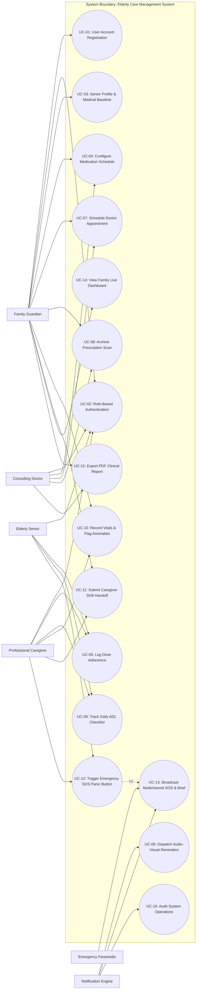
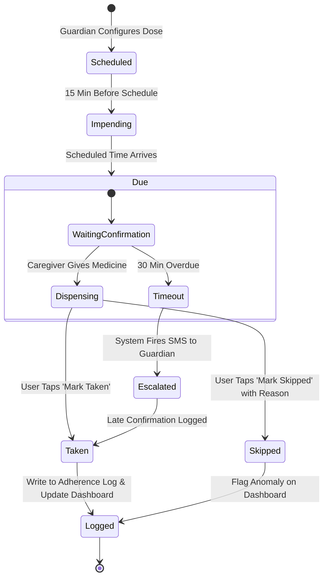
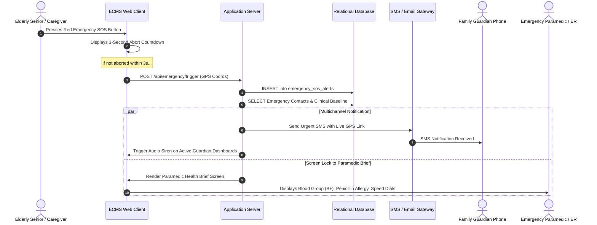
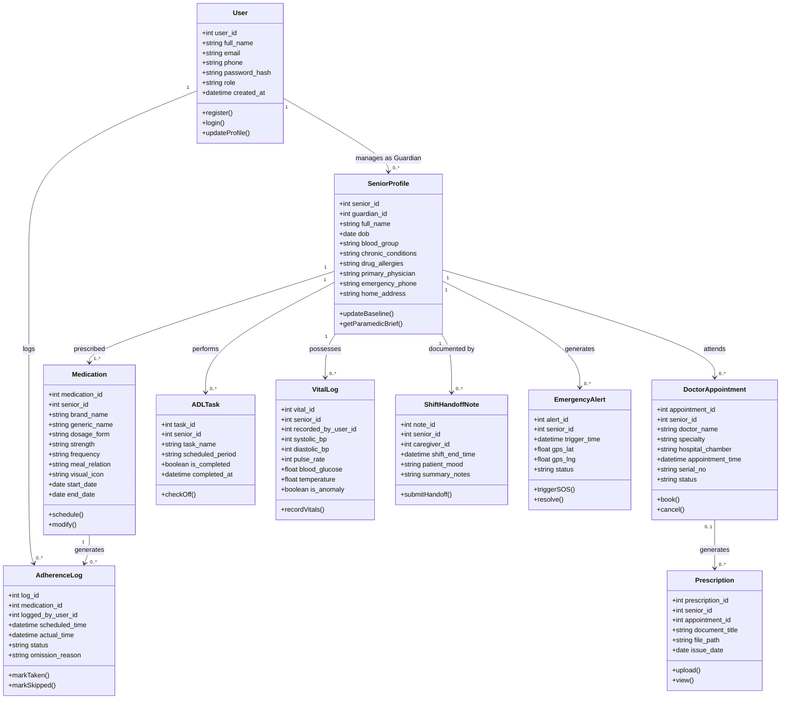

# Requirements Analysis Document (RAD)
## Elderly Care Management System

---

**Course Code:** CSE309  
**Course Title:** Web Programming (Section: 02, Autumn 2025)  
**Project Title:** Elderly Care Management System  
**Prepared By:** Farzana Sadia Takee  
**Student ID:** 2211175  
**Submitted To:** Md. Abu Sayed  
**Institution:** Independent University, Bangladesh (IUB)  
**Document Version:** 1.0 (Final)  
**Date of Submission:** October 2026  

---

## 1. Introduction & Analysis Methodology

### 1.1 Purpose of the Document
The **Requirements Analysis Document (RAD)** translates the raw qualitative user needs, field observations, and clinical insights gathered during the Requirements Elicitation phase into formal, rigorous software engineering specifications. It models the system's structural and behavioral capabilities using Object-Oriented Analysis (OOA), Unified Modeling Language (UML 2.5), formal Use Case Specifications, Activity Diagrams, State Machine Diagrams, Domain Class Architectures, and Relational Data Schemas.

This document serves as the authoritative technical baseline for software developers, system architects, UI/UX engineers, and quality assurance testers implementing the **Elderly Care Management System (ECMS)**.

### 1.2 System Scope & Operational Context
The Elderly Care Management System is a specialized, multi-role web-based healthcare coordination ecosystem designed to support senior citizens living in home environments. It harmonizes four distinct stakeholder groups:
1. **Elderly Senior Citizens** (Care Recipients seeking dignified autonomy and simplicity),
2. **Primary Family Guardians** (Accountable System Administrators managing profiles and oversight),
3. **Professional Home Caregivers / Nurse Aides** (Operational Frontline Users tracking tasks in real time), and
4. **Attending Doctors / Clinicians** (Medical Consultants reviewing objective longitudinal adherence).

The platform manages the end-to-end lifecycle of medication adherence, clinic appointments, daily Activities of Daily Living (ADLs), caregiver shift handoffs, and life-critical one-touch emergency SOS panic alerting.

### 1.3 Analysis Methodology
The analysis conforms to established IEEE software engineering best practices:
- **Functional Decomposition:** Hierarchical breakdown of system functions into modular, loosely coupled subsystems.
- **Unified Modeling Language (UML 2.5):** Structural and behavioral modeling using Use Case Diagrams, Activity Diagrams, State Machine Diagrams, and Domain Class Diagrams.
- **Formal Use Case Specifications:** Detailed tabular specifications capturing primary actors, preconditions, triggers, step-by-step nominal courses of events, alternative/exception flows, and postconditions.
- **MoSCoW Prioritization:** Rigorous classification of requirements into Must-Have, Should-Have, Could-Have, and Won't-Have categories.
- **Relational Data Dictionary:** Complete schema definition with data types, nullability, primary/foreign keys, and integrity constraints.

---

## 2. Comprehensive Feasibility Study

Following the requirement engineering framework established in Section 4.2 of the Software Requirements Specification (SRS), a formal five-dimensional feasibility study was executed:

| Feasibility Dimension | Analysis & Findings | Feasibility Assessment |
| :--- | :--- | :---: |
| **2.1 Technical Feasibility** | The system utilizes an industry-standard, battle-tested LAMP architecture (Linux, Apache, MySQL, PHP) augmented with modern JavaScript (ES6+), responsive HTML5, and CSS3. Open-source technologies eliminate proprietary vendor lock-in. Database queries are indexed to guarantee sub-200ms latency on standard relational lookups. The platform operates seamlessly across any modern web browser on Android, iOS, Windows, and macOS without requiring expensive specialized hardware. | **Highly Feasible** |
| **2.2 Economic Feasibility** | Development costs are primarily human engineering effort within an academic software development lifecycle. Operating costs are minimal: commodity cloud hosting ($10–$25/month) and transactional SMS gateway fees ($0.02/message for emergency alerts). Conversely, the economic return on investment (ROI) is exceptionally high: preventing a single preventable hospitalization caused by medication omission or fall-related complication saves thousands of dollars in emergency ICU expenditures. | **Highly Feasible** |
| **2.3 Operational Feasibility** | Operational adoption is the primary barrier in geriatric health systems. To ensure operational feasibility, the UI adheres to senior-centric accessibility guidelines (WCAG 2.1 AA): 16px+ typography, 4.5:1 contrast ratios, and minimum 48×48px touch targets. Frontline caregivers are provided with 1-tap toggle controls that eliminate text-heavy data entry. Family guardians receive automated notifications directly to their mobile devices, ensuring effortless daily oversight. | **Highly Feasible** |
| **2.4 Schedule Feasibility** | The project is structured across a disciplined 12-week academic semester (Activities A through Q, totaling 36 person-days) as modeled in the project Gantt chart (Fig 11). Core sprints are organized into: Planning (Weeks 1–2), Core User & Medicine Modules (Weeks 3–5), Daily Care & Emergency SOS (Weeks 6–8), System Integration & Testing (Weeks 9–10), and Documentation & Deployment (Weeks 11–12). | **Highly Feasible** |
| **2.5 Legal, Ethical & Privacy Feasibility** | Patient health data is inherently sensitive. The platform enforces strict Role-Based Access Control (RBAC), prevents unauthorized cross-tenant profile visibility, hashes all authentication passwords using strong cryptographic algorithms (Bcrypt), and maintains immutable audit logs for all data mutations in compliance with global health data privacy principles. | **Fully Compliant** |

---

## 3. Subsystem Architecture & Functional Decomposition

The Elderly Care Management System is decomposed into four cohesive primary subsystems and one supporting administrative module:

```mermaid
graph TD
    ECMS[Elderly Care Management System]

    ECMS --> SUB1[1. User Management Subsystem]
    ECMS --> SUB2[2. Medication Management Subsystem]
    ECMS --> SUB3[3. Appointment Management Subsystem]
    ECMS --> SUB4[4. Daily Care & Emergency SOS Subsystem]
    ECMS --> SUB5[5. Reporting & System Administration]

    SUB1 --> F1[FR-01: User Registration & Role Selection]
    SUB1 --> F2[FR-02: Role-Based Authentication & Session Security]
    SUB1 --> F3[FR-03: Senior Profile & Medical Baseline Setup]

    SUB2 --> F4[FR-04: Medication Scheduling & Visual Pill Config]
    SUB2 --> F5[FR-05: Real-Time Dose Adherence Logging]
    SUB2 --> F6[FR-06: Audio-Visual Pre-Alarms & Reminders]

    SUB3 --> F7[FR-07: Doctor Clinical Appointment Scheduling]
    SUB3 --> F8[FR-08: Prescription & Diagnostic Cloud Archive]

    SUB4 --> F9[FR-09: Daily ADL Routine Checklist]
    SUB4 --> F10[FR-10: Vitals Logging & Anomaly Flags]
    SUB4 --> F11[FR-11: Caregiver Shift Handoff Notes]
    SUB4 --> F12[FR-12: One-Touch Emergency SOS Panic Trigger]
    SUB4 --> F13[FR-13: Multichannel SOS Dispatch & Paramedic Brief]

    SUB5 --> F14[FR-14: Family Live Oversight Dashboard]
    SUB5 --> F15[FR-15: PDF Clinical Compliance Export]
    SUB5 --> F16[FR-16: Immutable System Audit Logging]
```

---

## 4. Detailed Use Case Modeling (UML 2.5)

### 4.1 Actor Catalog

| Actor Name | Type | System Responsibilities & Access Permissions |
| :--- | :--- | :--- |
| **Family Guardian (Admin)** | Primary Human Actor | Adult child or legal guardian. Has full administrative privileges: creates and edits senior profiles, configures medications, schedules doctor visits, invites caregivers, sets missed-dose escalation alerts, and reviews audit reports. |
| **Professional Caregiver (Nurse Aide)** | Primary Human Actor | Frontline care worker. Accesses mobile checklist: marks scheduled doses as dispensed, logs vital readings, checks off daily ADL routines, and writes mandatory shift handoff summaries. Cannot alter prescription parameters. |
| **Elderly Senior Citizen** | Primary Human Actor | Care recipient. Interacts via accessible high-contrast UI: views today's schedule, hears audio reminders, marks simple tasks as done, and triggers the one-touch Emergency SOS button. |
| **Consulting Physician / Doctor** | Secondary Human Actor | External clinical specialist. Reviews longitudinal medication adherence history, vital trend curves, and uploaded diagnostic prescriptions during consultations. |
| **Emergency Paramedic / ER Desk** | External Emergency Actor | First responder or triage nurse. Scans the Paramedic Health Brief during ambulance transit or ER intake to inspect blood group, chronic conditions, and fatal allergies. |
| **Automated Notification Engine** | System / Automated Actor | Background daemon/scheduler that evaluates medication schedules, fires reminder chimes, calculates overdue doses, and dispatches multi-channel alerts. |

### 4.2 Comprehensive System Use Case Diagram

---

### 4.3 Formal Use Case Specifications

#### Use Case UC-01: User Account Registration
- **Use Case ID:** UC-01
- **Primary Actor:** Family Guardian, Professional Caregiver, Consulting Doctor
- **Preconditions:** User has a valid email address and phone number; device is connected to the internet.
- **Trigger:** User navigates to the registration page and clicks "Create Account".
- **Nominal Course of Events (Main Flow):**
  1. System displays the registration form requesting Full Name, Email, Phone Number, Password, and Role (Guardian, Caregiver, Doctor).
  2. User enters required information and selects their role.
  3. System validates input data (format of email, minimum 8-character password strength, uniqueness of email).
  4. System hashes the password using Bcrypt.
  5. System creates a new record in the `users` database table with status `Active`.
  6. System creates a corresponding role-specific profile row.
  7. System generates an authentication session token and redirects user to their introductory dashboard.
- **Alternative / Exception Flows:**
  - *3a. Duplicate Email:* System displays error: "Email address is already registered. Please log in or reset password."
  - *3b. Weak Password:* System displays validation warning: "Password must contain at least 8 characters including a number and special character."
- **Postconditions:** New user account is established in the database with appropriate RBAC privileges.

---

#### Use Case UC-02: Role-Based Authentication & Session Security
- **Use Case ID:** UC-02
- **Primary Actor:** All Stakeholders (Guardian, Caregiver, Senior, Doctor)
- **Preconditions:** Registered user account exists.
- **Trigger:** User opens the application login screen.
- **Nominal Course of Events (Main Flow):**
  1. System presents login interface with Email/Phone and Password fields (with Quick PIN option for Seniors and Caregivers).
  2. User provides credentials and submits the form.
  3. System verifies credentials against stored cryptographic hash.
  4. System verifies user account status is `Active`.
  5. System generates an encrypted session cookie and logs the login timestamp to `audit_logs`.
  6. System routes user to their designated dashboard:
     - Guardian -> Central Oversight Dashboard
     - Caregiver -> Daily Checklist & Vitals Logging Screen
     - Senior -> High-Contrast Large-Font Schedule
     - Doctor -> Clinical Review & Patient History
- **Alternative / Exception Flows:**
  - *3a. Invalid Credentials:* System increments failed attempt counter and displays: "Invalid credentials. Please verify your password/PIN."
  - *3b. Account Lockout:* If 5 consecutive failed attempts occur within 10 minutes, system locks the account for 15 minutes and notifies the user via email.
- **Postconditions:** User is securely authenticated with role-scoped session permissions.

---

#### Use Case UC-03: Senior Profile & Medical Baseline Setup
- **Use Case ID:** UC-03
- **Primary Actor:** Family Guardian
- **Preconditions:** Guardian is logged in with Admin privileges.
- **Trigger:** Guardian selects "Senior Profile Setup" from the navigation menu.
- **Nominal Course of Events (Main Flow):**
  1. System displays senior baseline form: Full Name, Date of Birth, Blood Group, Primary Physician Name/Phone, Emergency Contact Priority List, Chronic Diagnoses, and Critical Drug Allergies.
  2. Guardian fills out all mandatory clinical fields (e.g., Blood Group: B+, Allergies: Penicillin - Anaphylaxis Risk).
  3. Guardian inputs home GPS coordinates or address for emergency dispatch.
  4. Guardian clicks "Save Profile".
  5. System validates mandatory fields and commits data to `senior_profiles`.
  6. System writes an entry to `audit_logs`.
  7. System displays confirmation banner: "Senior medical baseline saved successfully."
- **Alternative / Exception Flows:**
  - *5a. Missing Critical Safety Field:* If Blood Group or Allergy field is omitted, system halts submission and prompts: "Blood Group and Drug Allergies are mandatory for life-safety emergency protocols."
- **Postconditions:** Master clinical profile is established and mirrored to the Paramedic Health Brief.

---

#### Use Case UC-04: Configure Medication Schedule & Visual Pill Configurator
- **Use Case ID:** UC-04
- **Primary Actor:** Family Guardian, Consulting Doctor
- **Preconditions:** Senior profile exists; user has scheduling permissions.
- **Trigger:** User navigates to Medicine Manager and clicks "+ Add Scheduled Medication".
- **Nominal Course of Events (Main Flow):**
  1. System opens the Medication Scheduling modal.
  2. User inputs Brand Name (e.g., "Metformin 500mg"), Generic Name ("Metformin HCl"), Dosage Form ("Tablet"), and Quantity ("1 tablet").
  3. User selects Frequency ("Twice Daily") and assigns specific administration times (e.g., "08:00 AM", "08:00 PM").
  4. User defines Meal Rule ("After Meal - Breakfast", "After Meal - Dinner").
  5. User selects a Visual Pill Card icon (Shape: Oval, Color: White, Marking: Score Line) to facilitate physical pill identification.
  6. User inputs Start Date, End Date, and Prescribing Doctor.
  7. User clicks "Confirm Schedule".
  8. System stores data in `medications` and generates recurring scheduled slots in `adherence_logs`.
- **Alternative / Exception Flows:**
  - *8a. Scheduling Conflict:* If two potent interacting drugs are scheduled at the identical time, system displays a warning modal requesting confirmation.
- **Postconditions:** Recurring medication schedule is established and visible on daily checklists.

---

#### Use Case UC-05: Real-Time Dose Adherence Logging
- **Use Case ID:** UC-05
- **Primary Actor:** Professional Caregiver, Elderly Senior
- **Preconditions:** Active medication schedule exists for the current date.
- **Trigger:** User views today's medication list and dispenses a scheduled dose.
- **Nominal Course of Events (Main Flow):**
  1. System displays today's chronological pill card timeline with pending doses highlighted.
  2. User locates the due dose (e.g., "08:00 AM Metformin 500mg").
  3. User taps the prominent green "Mark Taken" button.
  4. System updates the status in `adherence_logs` to `Taken`, records exact timestamp, and tags the user ID.
  5. System displays a checkmark animation and plays an auditory confirmation chime.
  6. System broadcasts an update to the Family Live Dashboard.
- **Alternative / Exception Flows:**
  - *3a. Dose Omitted / Refused:* User selects "Mark Skipped" or "Patient Refused". System mandates entering an omission reason (e.g., "Patient experienced nausea"). System marks status as `Skipped` and flags an alert on the Guardian dashboard.
- **Postconditions:** Medication adherence record is permanently recorded with audit trail.

---

#### Use Case UC-06: Dispatch Audio-Visual Reminders & Pre-Alarms
- **Use Case ID:** UC-06
- **Primary Actor:** Automated Notification Engine
- **Secondary Actor:** Elderly Senior, Caregiver
- **Preconditions:** Scheduled medication dose is approaching within 15 minutes.
- **Trigger:** System cron daemon detects impending dose timestamp.
- **Nominal Course of Events (Main Flow):**
  1. Notification daemon identifies upcoming doses due in the next 15 minutes.
  2. System pushes a high-contrast visual banner to active browser sessions.
  3. System triggers a pleasant, penetrating audio chime via Web Audio API.
  4. System displays the visual pill icon, medicine name, and meal relation instruction.
  5. If dose remains unconfirmed 30 minutes post-schedule, system escalates: generates an SMS alert to the Family Guardian.
- **Alternative / Exception Flows:**
  - *2a. Device Offline:* System stores notification in browser service worker queue and sounds alarm immediately upon device reconnect.
- **Postconditions:** Users are alerted; escalation timers are managed until confirmation.

---

#### Use Case UC-07: Doctor Clinical Appointment Scheduling
- **Use Case ID:** UC-07
- **Primary Actor:** Family Guardian, Consulting Doctor
- **Preconditions:** Senior profile exists.
- **Trigger:** Guardian clicks "Book Doctor Appointment".
- **Nominal Course of Events (Main Flow):**
  1. System presents appointment booking form: Doctor Name, Specialty, Hospital / Chamber Location, Date, Time, Serial Number, and Reason for Consultation.
  2. Guardian enters appointment details and attaches relevant symptom notes.
  3. System validates that appointment date is in the future.
  4. System writes record to `doctor_appointments` with status `Scheduled`.
  5. System sets automated calendar reminder notifications 24 hours and 2 hours prior to visit.
  6. System displays appointment card on Guardian and Caregiver dashboards.
- **Alternative / Exception Flows:**
  - *3a. Past Date Selected:* System displays validation error: "Appointment date must be in the future."
- **Postconditions:** Clinical appointment is scheduled and tracked across all dashboards.

---

#### Use Case UC-08: Prescription & Diagnostic Cloud Archive
- **Use Case ID:** UC-08
- **Primary Actor:** Family Guardian, Consulting Doctor
- **Preconditions:** Appointment or consultation has occurred.
- **Trigger:** User clicks "+ Upload Prescription / Diagnostic Report".
- **Nominal Course of Events (Main Flow):**
  1. System opens file upload modal accepting JPEG, PNG, or PDF formats (max 10MB).
  2. User selects digital file, specifies Document Title, Prescribing Doctor, Date, and Document Type (Prescription, Blood Panel, ECG, Discharge Summary).
  3. System validates file mime-type and scans for malicious content.
  4. System stores encrypted file in secure cloud storage directory and inserts metadata into `prescriptions`.
  5. System links prescription record to the senior profile and relevant appointment.
  6. System renders an instant thumbnail preview in the document archive gallery.
- **Alternative / Exception Flows:**
  - *3a. Invalid File Format:* System rejects file: "Unsupported file type. Please upload PDF, JPEG, or PNG."
  - *3b. File Exceeds Size Limit:* System displays: "File exceeds 10MB limit. Please compress image."
- **Postconditions:** Document is securely archived, searchable, and retrievable for future consultations.

---

#### Use Case UC-09: Track Daily ADL Routine Checklist
- **Use Case ID:** UC-09
- **Primary Actor:** Professional Caregiver, Elderly Senior
- **Preconditions:** Senior has an active daily care plan.
- **Trigger:** Caregiver begins daily shift and opens "Daily ADL Checklist".
- **Nominal Course of Events (Main Flow):**
  1. System renders today's structured checklist: Morning Hygiene, Diabetic Breakfast, Hydration Target (2L), Assisted Walking / Mobility, Lunch, Afternoon Rest, Evening Walk, Dinner, and Bedtime Routine.
  2. Caregiver taps completion checkmark for each task as it is performed.
  3. System updates task status in `adl_tasks` with timestamp and caregiver user ID.
  4. System recalculates daily ADL completion percentage bar.
  5. System displays updated progress to Family Guardian dashboard in real time.
- **Postconditions:** Non-medical care routines are tracked with full accountability.

---

#### Use Case UC-10: Vitals Logging & Physiological Anomaly Alerting
- **Use Case ID:** UC-10
- **Primary Actor:** Professional Caregiver, Family Guardian
- **Preconditions:** Caregiver is logged in; senior is present.
- **Trigger:** Caregiver measures physiological vitals and clicks "Log Vitals".
- **Nominal Course of Events (Main Flow):**
  1. System displays vitals input form: Systolic BP (mmHg), Diastolic BP (mmHg), Pulse Rate (bpm), Blood Glucose (mmol/L or mg/dL), Body Temperature (°F), and Context (Fasting / Post-prandial).
  2. Caregiver enters measured numbers and submits.
  3. System validates inputs against plausible physiological ranges (e.g., Systolic between 60 and 260).
  4. System evaluates values against clinical threshold rules:
     - Normal: Systolic 100–130, Diastolic 60–85, Glucose 4.0–7.8 mmol/L
     - Anomaly Flag: Systolic > 140 or < 90, Glucose > 11.1 or < 3.9 mmol/L
  5. System commits reading to `vital_logs`.
  6. If anomaly is detected, system paints reading in bold red, displays visual warning modal, and dispatches instant SMS alert to Family Guardian.
- **Alternative / Exception Flows:**
  - *3a. Implausible Value:* If user types Systolic "400", system alerts: "Value outside plausible human range. Please re-check measurement."
- **Postconditions:** Vital signs are recorded and plotted on longitudinal trend charts.

---

#### Use Case UC-11: Submit Caregiver Shift Handoff Notes
- **Use Case ID:** UC-11
- **Primary Actor:** Professional Caregiver
- **Secondary Actor:** Family Guardian
- **Preconditions:** Caregiver is concluding their daily work shift.
- **Trigger:** Caregiver selects "Complete Shift Handoff" before clocking out.
- **Nominal Course of Events (Main Flow):**
  1. System aggregates today's logged data: total doses administered, missed doses, recorded vitals, and ADL tasks completed.
  2. System prompts caregiver to complete mandatory handoff questions:
     - General Patient Mood / Cognitive State (Alert, Drowsy, Agitated)
     - Appetite & Hydration Summary
     - Special Clinical Observations or Incidents (e.g., "Uncle stumbled near the bathroom at 3 PM, no bruises, complained of slight knee pain")
  3. Caregiver inputs notes and clicks "Sign & Submit Handoff".
  4. System time-stamps the record, commits to `shift_handoff_notes`, and closes caregiver shift session.
  5. System sends push notification and email summary to Family Guardian.
- **Alternative / Exception Flows:**
  - *3a. Blank Observations:* System mandates minimum 15 characters of summary text to prevent empty submissions.
- **Postconditions:** Immutable, time-stamped shift handoff is preserved for legal and operational continuity.

---

#### Use Case UC-12: Trigger One-Touch Emergency SOS Panic Button
- **Use Case ID:** UC-12
- **Primary Actor:** Elderly Senior, Professional Caregiver
- **Preconditions:** Medical crisis or physical fall has occurred.
- **Trigger:** User taps the prominent red "EMERGENCY SOS" button permanently anchored on the viewport.
- **Nominal Course of Events (Main Flow):**
  1. User presses the Emergency SOS button.
  2. System displays a 3-second abort countdown with loud pulsing tone (to prevent accidental triggers).
  3. If not cancelled within 3 seconds, system activates Emergency Protocol (UC-13).
  4. System captures device geolocation coordinates (GPS latitude/longitude).
  5. System transitions screen immediately to the **Paramedic Health Brief** display.
- **Alternative / Exception Flows:**
  - *2a. Accidental Press:* User taps "Cancel" within 3-second countdown window; system logs false-alarm event and resumes standard display.
- **Postconditions:** Emergency broadcast protocol is irrevocably initiated.

---

#### Use Case UC-13: Broadcast Multichannel SOS Alert & Paramedic Brief
- **Use Case ID:** UC-13
- **Primary Actor:** Automated Notification Engine, Emergency Paramedic
- **Preconditions:** Emergency SOS has been triggered (UC-12).
- **Trigger:** System enters active emergency state.
- **Nominal Course of Events (Main Flow):**
  1. System queries registered emergency contacts for the senior from `senior_profiles`.
  2. System dispatches urgent SMS messages containing:
     - "EMERGENCY SOS: [Senior Name] has triggered medical panic alarm at [Timestamp]!"
     - Live Google Maps GPS location link
     - Primary Guardian contact number
  3. System initiates automated browser siren alarm on all open Guardian dashboard sessions.
  4. System formats and locks screen on the **Paramedic Critical Health Brief**:
     - Senior Full Name, Age, Blood Group (Prominently in red, e.g., **B POSITIVE**)
     - Critical Drug Allergies (e.g., **FATAL PENICILLIN ANAPHYLAXIS**)
     - Active Medications (e.g., Aspirin, Metformin, Losartan)
     - Chronic Diagnoses (Coronary Stent, Hypertension)
     - Single-tap speed dials: National Ambulance (999/199), Hospital ER (10616), Primary Doctor direct line.
  5. System records complete event timeline in `emergency_sos_alerts`.
- **Postconditions:** Emergency services and family are mobilized; first responders receive instant clinical context.

---

#### Use Case UC-14: View Family Live Oversight Dashboard
- **Use Case ID:** UC-14
- **Primary Actor:** Family Guardian
- **Preconditions:** Guardian is logged in.
- **Trigger:** Guardian navigates to home route `/dashboard`.
- **Nominal Course of Events (Main Flow):**
  1. System queries database and renders real-time dashboard widgets:
     - Today's Medication Adherence Gauge (e.g., "75% - 3 of 4 Doses Taken")
     - Latest Vitals Card with physiological indicators (BP 125/82, Glucose 6.2 mmol/L)
     - Daily ADL Checklist Progress Bar
     - Upcoming Doctor Appointments (Next: Dr. Mahbub Hasan in 3 days)
     - Recent Activity Feed (Time-stamped audit logs of caregiver actions)
  2. Guardian interacts with widgets to filter by date or drill down into specific module details.
- **Postconditions:** Guardian obtains complete operational visibility of eldercare.

---

#### Use Case UC-15: Export PDF Clinical Compliance & Health Report
- **Use Case ID:** UC-15
- **Primary Actor:** Family Guardian, Consulting Doctor
- **Preconditions:** Historical adherence and vital data exist.
- **Trigger:** User selects "Export Health Report" and picks date range (e.g., "Last 30 Days").
- **Nominal Course of Events (Main Flow):**
  1. System compiles senior clinical baseline, adherence percentages per medication, vital sign trend data, and doctor visit logs over the selected range.
  2. System formats data into a clean, printable clinical summary report with institutional header and student/academic credentials.
  3. System streams compiled PDF file to user browser for immediate download or printing.
- **Postconditions:** Standardized clinical document is generated for physical doctor consultations.

---

#### Use Case UC-16: Immutable System Audit Logging
- **Use Case ID:** UC-16
- **Primary Actor:** System Administrator, Automated Audit Daemon
- **Preconditions:** System event or user mutation occurs.
- **Trigger:** Any database insert, update, delete, failed login, or emergency SOS trigger.
- **Nominal Course of Events (Main Flow):**
  1. Application interceptor captures event parameters: User ID, IP Address, HTTP Request Method, Target Table, Previous Value, New Value, and Exact Server Timestamp.
  2. System writes immutable record to `audit_logs`.
  3. If suspicious behavior is detected (e.g., rapid failed logins or unauthorized role escalation attempts), system flags event for security review.
- **Postconditions:** Complete forensic audit trail is preserved.

---

## 5. Behavioral & Dynamic Analysis

### 5.1 Activity Diagram: Medication Scheduling & Dispensation Workflow

---

### 5.2 Activity Diagram: Emergency SOS Panic & Multichannel Dispatch

---

## 6. Structural Domain Analysis & Data Modeling

### 6.1 Domain Class Diagram

---

### 6.2 Relational Data Dictionary

The data dictionary formally defines all database relations, data types, nullability, keys, and operational constraints:

#### Table 1: `users`
| Column Name | Data Type | Nullable | Key | Constraints & Description |
| :--- | :--- | :---: | :---: | :--- |
| `user_id` | INT AUTO_INCREMENT | No | PK | Unique surrogate primary key. |
| `full_name` | VARCHAR(100) | No | - | Full legal name of registered user. |
| `email` | VARCHAR(120) | No | Unique | Unique email for authentication and notifications. |
| `phone` | VARCHAR(20) | No | Unique | Contact telephone number with country code. |
| `password_hash` | VARCHAR(255) | No | - | Cryptographic Bcrypt hash of user password. |
| `role` | ENUM | No | - | Allowed values: `'Guardian'`, `'Caregiver'`, `'Senior'`, `'Doctor'`, `'Admin'`. |
| `created_at` | DATETIME | No | - | Record creation timestamp. |

#### Table 2: `senior_profiles`
| Column Name | Data Type | Nullable | Key | Constraints & Description |
| :--- | :--- | :---: | :---: | :--- |
| `senior_id` | INT AUTO_INCREMENT | No | PK | Unique senior profile identifier. |
| `guardian_id` | INT | No | FK | References `users(user_id)`. Designated family admin. |
| `full_name` | VARCHAR(100) | No | - | Full legal name of senior citizen. |
| `dob` | DATE | No | - | Date of birth for age calculation. |
| `blood_group` | ENUM | No | - | Allowed values: `'A+'`, `'A-'`, `'B+'`, `'B-'`, `'AB+'`, `'AB-'`, `'O+'`, `'O-'`. |
| `chronic_conditions`| TEXT | Yes | - | Comma-separated diagnoses (e.g., "Hypertension, Type 2 Diabetes"). |
| `drug_allergies` | TEXT | No | - | Mandatory clinical safety field (e.g., "Penicillin - Anaphylaxis"). |
| `primary_physician` | VARCHAR(100) | Yes | - | Name of primary consulting clinician. |
| `emergency_phone` | VARCHAR(20) | No | - | Priority family contact number for SOS speed dial. |
| `home_address` | TEXT | No | - | Residential street address for emergency dispatch. |

#### Table 3: `medications`
| Column Name | Data Type | Nullable | Key | Constraints & Description |
| :--- | :--- | :---: | :---: | :--- |
| `medication_id` | INT AUTO_INCREMENT | No | PK | Unique medication identifier. |
| `senior_id` | INT | No | FK | References `senior_profiles(senior_id)`. |
| `brand_name` | VARCHAR(100) | No | - | Commercial brand name (e.g., "Metformin 500mg"). |
| `generic_name` | VARCHAR(100) | Yes | - | Active pharmacological generic name ("Metformin HCl"). |
| `dosage_form` | VARCHAR(50) | No | - | Form: `'Tablet'`, `'Capsule'`, `'Syrup'`, `'Injection'`, `'Inhaler'`. |
| `strength` | VARCHAR(50) | No | - | Quantitative strength (e.g., "500mg", "10ml"). |
| `frequency` | VARCHAR(50) | No | - | Schedule frequency (e.g., "Twice Daily", "Once at Bedtime"). |
| `meal_relation` | VARCHAR(50) | No | - | Allowed values: `'Before Meal'`, `'After Meal'`, `'With Meal'`, `'Empty Stomach'`. |
| `visual_icon` | VARCHAR(50) | No | - | Icon token for pill recognition (e.g., `'pill-white-oval'`). |
| `start_date` | DATE | No | - | Prescribed treatment commencement date. |
| `end_date` | DATE | Yes | - | Prescribed course completion date (NULL for indefinite). |

#### Table 4: `adherence_logs`
| Column Name | Data Type | Nullable | Key | Constraints & Description |
| :--- | :--- | :---: | :---: | :--- |
| `log_id` | INT AUTO_INCREMENT | No | PK | Unique adherence log identifier. |
| `medication_id` | INT | No | FK | References `medications(medication_id)`. |
| `logged_by_user_id`| INT | Yes | FK | References `users(user_id)`. NULL if automated system record. |
| `scheduled_time`| DATETIME | No | - | Exact planned dosage timestamp. |
| `actual_time` | DATETIME | Yes | - | Exact recorded dispensation timestamp. |
| `status` | ENUM | No | - | Allowed values: `'Scheduled'`, `'Taken'`, `'Missed'`, `'Skipped'`. |
| `omission_reason` | TEXT | Yes | - | Mandatory text explanation if status is `'Skipped'`. |

#### Table 5: `doctor_appointments`
| Column Name | Data Type | Nullable | Key | Constraints & Description |
| :--- | :--- | :---: | :---: | :--- |
| `appointment_id` | INT AUTO_INCREMENT | No | PK | Unique clinical appointment identifier. |
| `senior_id` | INT | No | FK | References `senior_profiles(senior_id)`. |
| `doctor_name` | VARCHAR(100) | No | - | Name of consulting physician. |
| `specialty` | VARCHAR(100) | No | - | Clinical specialty (e.g., "Cardiology", "Geriatrics"). |
| `hospital_chamber`| VARCHAR(150) | No | - | Clinic, hospital name, and chamber room number. |
| `appointment_time`| DATETIME | No | - | Scheduled appointment date and time. |
| `serial_no` | VARCHAR(20) | Yes | - | Clinic queue serial or token number. |
| `status` | ENUM | No | - | Allowed values: `'Scheduled'`, `'Completed'`, `'Cancelled'`, `'Missed'`. |

#### Table 6: `vital_logs`
| Column Name | Data Type | Nullable | Key | Constraints & Description |
| :--- | :--- | :---: | :---: | :--- |
| `vital_id` | INT AUTO_INCREMENT | No | PK | Unique physiological reading identifier. |
| `senior_id` | INT | No | FK | References `senior_profiles(senior_id)`. |
| `recorded_by_user_id`| INT | No | FK | References `users(user_id)`. |
| `systolic_bp` | INT | Yes | - | Systolic blood pressure (mmHg). Plausible range: 60–260. |
| `diastolic_bp` | INT | Yes | - | Diastolic blood pressure (mmHg). Plausible range: 40–160. |
| `pulse_rate` | INT | Yes | - | Heart rate (beats per minute). Plausible range: 30–220. |
| `blood_glucose` | DECIMAL(4,1) | Yes | - | Glucose level (mmol/L). Plausible range: 1.0–35.0. |
| `temperature` | DECIMAL(4,1) | Yes | - | Body temperature (°F). Plausible range: 94.0–108.0. |
| `is_anomaly` | BOOLEAN | No | - | Flagged TRUE if values breach clinical safety thresholds. |
| `recorded_at` | DATETIME | No | - | Timestamp of measurement. |

#### Table 7: `shift_handoff_notes`
| Column Name | Data Type | Nullable | Key | Constraints & Description |
| :--- | :--- | :---: | :---: | :--- |
| `note_id` | INT AUTO_INCREMENT | No | PK | Unique shift handoff record identifier. |
| `senior_id` | INT | No | FK | References `senior_profiles(senior_id)`. |
| `caregiver_id` | INT | No | FK | References `users(user_id)`. Outgoing caregiver. |
| `shift_end_time` | DATETIME | No | - | Timestamp when shift was completed. |
| `patient_mood` | ENUM | No | - | Allowed values: `'Alert & Cheerful'`, `'Calm'`, `'Drowsy'`, `'Agitated'`, `'Confused'`. |
| `summary_notes` | TEXT | No | - | Structured observations, incidents, and handoff instructions. |

#### Table 8: `emergency_sos_alerts`
| Column Name | Data Type | Nullable | Key | Constraints & Description |
| :--- | :--- | :---: | :---: | :--- |
| `alert_id` | INT AUTO_INCREMENT | No | PK | Unique emergency panic alert identifier. |
| `senior_id` | INT | No | FK | References `senior_profiles(senior_id)`. |
| `trigger_time` | DATETIME | No | - | Exact timestamp of panic button trigger. |
| `gps_lat` | DECIMAL(10,8)| Yes | - | Latitude coordinate at moment of trigger. |
| `gps_lng` | DECIMAL(11,8)| Yes | - | Longitude coordinate at moment of trigger. |
| `status` | ENUM | No | - | Allowed values: `'Active'`, `'Resolved'`, `'False Alarm'`. |
| `resolved_at` | DATETIME | Yes | - | Timestamp when emergency state was deactivated. |

---

## 7. MoSCoW Requirements Prioritization Matrix

To balance technical feasibility, project schedule constraints (36 person-days across 12 academic weeks), and clinical life-safety priorities, all 16 functional requirements were classified using the MoSCoW methodology:

| Priority Category | Feature ID | Feature Name | Clinical / Operational Justification |
| :--- | :---: | :--- | :--- |
| **Must Have** | **FR-01** | User Account Registration | Mandatory foundation for role allocation and system access. |
| | **FR-02** | Role-Based Authentication | Enforces security boundaries and prevents unauthorized data alteration. |
| | **FR-03** | Senior Profile Management | Establishes clinical baseline (blood group, allergies) essential for life-safety. |
| | **FR-04** | Medication Scheduling | Core clinical purpose: sets up structured daily medication regimens. |
| | **FR-05** | Real-Time Dose Logging | Essential 1-tap tracking to verify daily medication compliance. |
| | **FR-07** | Doctor Appointment Scheduling | Prevents missed follow-up consultations with medical specialists. |
| | **FR-10** | Vitals Recording & Anomaly Flags| Critical for identifying dangerous hypertensive spikes and hypoglycemic drops. |
| | **FR-12** | One-Touch Emergency SOS Trigger| Life-critical panic alert for acute medical crises (falls, cardiac events). |
| | **FR-13** | Multichannel SOS & Paramedic Brief| Instant multi-stakeholder alert and 5-second clinical summary for paramedics. |
| | **FR-16** | System Audit Trail Logging | Enforces regulatory compliance, forensic accountability, and security auditability. |
| **Should Have** | **FR-06** | Audio-Visual Reminders | Reduces accidental omission by alerting seniors 15 minutes before due time. |
| | **FR-08** | Prescription Cloud Archive | Eliminates misplaced paper prescriptions and lost diagnostic reports. |
| | **FR-09** | Daily ADL Routine Checklist | Standardizes non-medical daily caregiving routines (meals, hydration, mobility). |
| | **FR-11** | Caregiver Shift Handoff Notes | Eliminates verbal communication breakdowns between caregiver shifts. |
| | **FR-14** | Family Live Oversight Dashboard | Provides working adult children with real-time reassurance and trend analytics. |
| **Could Have** | **FR-15** | PDF Clinical Compliance Export | Enhances doctor consultations by generating printable monthly compliance summaries. |
| **Won't Have** | *WH-01* | Live Telehealth Video Calling | Deferred to Phase 2; external teleconsultation platforms are used in interim. |
| | *WH-02* | Automated IoT Pillbox Hardware | Hardware integration deferred to Phase 2 to preserve pure web accessibility. |

---

## 8. Non-Functional Requirements (NFR) Analysis

| Dimension | NFR ID | Requirement Specification | Metric / Benchmark | Verification Method |
| :--- | :---: | :--- | :--- | :--- |
| **Performance** | NFR-01 | Page Load & Rendering Speed | Initial dashboard loads under 2.0s over 4G/WiFi. | Chrome Lighthouse Performance Audit |
| | NFR-02 | Database Query Latency | Relational lookups return in <200ms under 100 concurrent requests. | Apache JMeter Stress Testing |
| | NFR-03 | Emergency Alert Dispatch Speed | Multichannel SMS and push alerts dispatched within 5 seconds of SOS press. | Real-time timestamp logging audit |
| **Security** | NFR-04 | Password Cryptography | Passwords hashed using Bcrypt with work factor of 12. | Code review and penetration testing |
| | NFR-05 | Transport Layer Security | All communications encrypted via HTTPS/TLS 1.3 with HSTS enabled. | SSL Labs A+ Verification |
| | NFR-06 | SQL Injection Prevention | All database interactions execute via PDO Prepared Statements. | Static Application Security Testing (SAST) |
| **Accessibility** | NFR-07 | Senior-Centric Visual Ergonomics | Minimum font size of 16px; contrast ratios exceeding 4.5:1 (WCAG 2.1 AA). | WAVE Accessibility Evaluation Tool |
| | NFR-08 | Minimum Touch Target Boundaries | All interactive buttons possess touch targets of at least 48×48 CSS pixels. | Mobile viewport touch target audit |
| **Reliability** | NFR-09 | System Availability | System achieves 99.9% uptime during operational service hours. | Server uptime ping monitoring |
| | NFR-10 | Data Durability & Backup | Automated nightly encrypted database dumps with 30-day snapshot retention. | Disaster recovery test restore |

---

## 9. Requirements Traceability Matrix (RTM)

The Requirements Traceability Matrix guarantees complete bidirectional alignment from elicited User Needs (UN) through Functional Requirements (FR), Use Cases (UC), Relational Entities, and Quality Assurance Test Cases (TC):

| User Need | Functional Requirement | Use Case | Database Relation | Test Case ID | Verification Target |
| :---: | :---: | :---: | :---: | :---: | :--- |
| **UN-01** | **FR-01** | **UC-01** | `users` | TC-01 | User successfully registers with assigned role. |
| **UN-02** | **FR-02** | **UC-02** | `users`, `audit_logs` | TC-02 | Valid credentials generate secure session; invalid lock account. |
| **UN-03** | **FR-03** | **UC-03** | `senior_profiles` | TC-03 | Clinical baseline, blood group, and allergies saved and mirrored. |
| **UN-04** | **FR-04** | **UC-04** | `medications` | TC-04 | Medication schedule created with visual pill icon and meal rule. |
| **UN-05** | **FR-05** | **UC-05** | `adherence_logs` | TC-05 | 1-tap 'Taken' updates status; 'Skipped' mandates reason. |
| **UN-06** | **FR-06** | **UC-06** | `adherence_logs` | TC-06 | Audio chime and visual banner trigger 15 min prior to dose. |
| **UN-07** | **FR-07** | **UC-07** | `doctor_appointments` | TC-07 | Doctor visit booked; automated reminders set in calendar. |
| **UN-08** | **FR-08** | **UC-08** | `prescriptions` | TC-08 | Prescription image uploaded and linked to appointment record. |
| **UN-09** | **FR-09** | **UC-09** | `adl_tasks` | TC-09 | ADL tasks checked off; progress bar updates on dashboard. |
| **UN-10** | **FR-10** | **UC-10** | `vital_logs` | TC-10 | Vitals logged; hypertensive/hypoglycemic values flagged in red. |
| **UN-11** | **FR-11** | **UC-11** | `shift_handoff_notes` | TC-11 | Shift handoff note submitted with mood and mandatory summary. |
| **UN-12** | **FR-12** | **UC-12** | `emergency_sos_alerts`| TC-12 | Emergency SOS button triggers 3s countdown and captures GPS. |
| **UN-13** | **FR-13** | **UC-13** | `emergency_sos_alerts`| TC-13 | SMS dispatched to family; Paramedic Health Brief rendered. |
| **UN-14** | **FR-14** | **UC-14** | Multi-table Query | TC-14 | Family dashboard renders adherence gauge, vitals, and feed. |
| **UN-15** | **FR-15** | **UC-15** | Export Service | TC-15 | PDF compliance report compiles and downloads cleanly. |
| **UN-16** | **FR-16** | **UC-16** | `audit_logs` | TC-16 | All database mutations write immutable, time-stamped logs. |

---

## 10. Conclusion & Next Phase Transition

The **Requirements Analysis Document (RAD)** establishes an exhaustive, mathematically sound, and clinically validated software engineering specification for the **Elderly Care Management System**. By formalizing functional decomposition, detailed UML 2.5 use cases, dynamic activity workflows, structural class diagrams, and strict relational schemas, all ambiguity is eliminated.

This analytical baseline directly empowers the technical implementation team to proceed with architectural design, database migration scripts, frontend UI component construction, and comprehensive automated test suite development.
