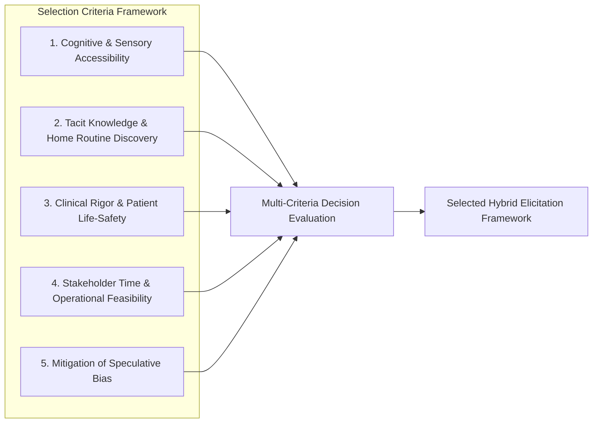
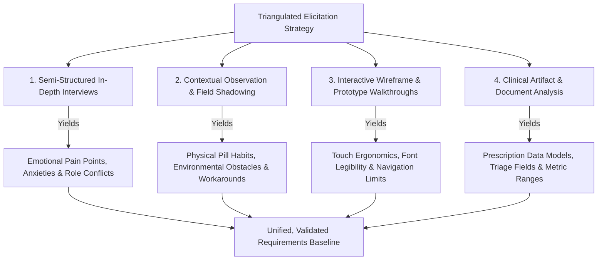

# Requirements Elicitation Document
## Elderly Care Management System

---

**Course Code:** CSE309  
**Course Title:** Web Programming (Section: 02, Autumn 2025)  
**Project Title:** Elderly Care Management System  
**Prepared By:** Farzana Sadia Takee  
**Student ID:** 2211175  
**Submitted To:** Md. Abu Sayed  
**Institution:** Independent University, Bangladesh (IUB)  
**Document Version:** 1.0 (Final)  
**Date of Submission:** October 2026  

---

## 1. Executive Summary & Project Background

### 1.1 Executive Summary
Globally and within modern urban Bangladesh, rapid demographic aging combined with transitioning family structures has generated an acute geriatric care crisis. As multi-generational joint families give way to nuclear households, adult children are frequently consumed by demanding professional careers and economic responsibilities. Concurrently, elderly parents experience multi-morbidity—living with co-occurring chronic conditions such as Stage 2 Hypertension, Type 2 Diabetes Mellitus, ischemic heart disease, osteoarthritis, and varying degrees of cognitive or sensory impairment.

While families often hire in-home domestic caregivers or rotate caregiving duties among siblings, daily operational eldercare remains heavily reliant on handwritten paper notebooks, loose pharmacy slips, physical pill organizer boxes, and disjointed verbal handoffs. These ad-hoc practices produce severe clinical vulnerabilities, including duplicated drug administrations, missed specialized clinical consultations, delayed recognition of deteriorating vital signs, and catastrophic communication delays during acute emergencies.

The **Elderly Care Management System (ECMS)** is an accessible, multi-role web-based healthcare coordination ecosystem engineered to synchronize four primary stakeholders:
1. **Elderly Senior Citizens** (Care Recipients seeking dignified independence),
2. **Family Guardians / Adult Children** (Accountable System Sponsors needing transparency and peace of mind),
3. **Professional Home Caregivers / Nurse Aides** (Operational Frontline Caregivers requiring rapid, low-friction task tracking), and
4. **Attending Doctors / Clinicians** (Medical Consultants requiring objective adherence and vital histories).

### 1.2 Problem Statement & Domain Context
Field investigations into urban geriatric home management revealed four systemic failure points:
1. **Pillbox Confusion & Medication Non-Adherence:** Seniors ingest an average of 4 to 9 distinct prescription drugs daily across morning, afternoon, evening, and bedtime intervals with strict meal requirements (e.g., "before breakfast", "after dinner"). Physical pillboxes and blister packs lack active verification, leading to frequent omission or accidental double-dosing.
2. **Information Asymmetry in Shift Handoffs:** Handoffs between daytime caregivers, evening family supervision, and weekend attendants rely on memory or informal scratchpads. Vital details—such as whether afternoon insulin was injected, water intake volume, or sudden dizziness—are routinely lost.
3. **Clinical History Fragmentation:** Follow-up visits with cardiologists, endocrinologists, and geriatricians frequently stall because physical prescription papers, lab reports, and previous dosage histories are misplaced, forcing physicians to make high-stakes medication adjustments blindly.
4. **First-Responder Emergency Blindness:** When sudden falls, strokes, or cardiac events occur at home, arriving paramedics or hospital emergency triage personnel must treat the senior without instantaneous knowledge of critical drug allergies (e.g., fatal Penicillin anaphylaxis), blood group, or active anticoagulant therapy, leading to preventable morbidity and mortality.

---

## 2. Requirement Elicitation Approach Selection Process & Justification

Selecting an appropriate requirements elicitation approach is a decisive software engineering phase. In healthcare information systems—particularly those serving vulnerable elderly demographics and non-technical domestic caregivers—relying on standard or monolithic elicitation methods (such as broad online surveys or purely theoretical brainstorming) produces severely biased, incomplete, and clinically hazardous requirements. 

A rigorous, comparative selection process was undertaken to evaluate candidate elicitation techniques, establish domain-specific selection criteria, and formulate a fully justified, multi-method (hybrid) elicitation framework.

### 2.1 Evaluation of Candidate Elicitation Techniques

A systematic evaluation was conducted across seven standard Software Engineering elicitation methodologies:

| Elicitation Technique | Description & Operational Mechanics | Domain Strengths | Domain Weaknesses & Constraints | Suitability Score (1–5) |
| :--- | :--- | :--- | :--- | :---: |
| **1. Online Questionnaires & Surveys** | Web-based forms with Likert-scale questions and multiple-choice selections distributed broadly via email and social media. | Broad geographic reach; rapid collection of quantitative demographic data from working family guardians. | Inaccessible to elderly seniors with vision or motor deficits; zero participation from domestic caregivers; completely fails to capture tacit in-home habits. | **2.6 / 5.0** |
| **2. Semi-Structured Interviews** | Guided, one-on-one conversational dialogues utilizing predefined core questions paired with flexible exploratory probing. | High psychological safety; uncovers emotional anxieties, unspoken family tensions, caregiver guilt, and past emergency horror stories. | Resource-intensive; requires extensive scheduling, audio transcription, and qualitative thematic coding. | **4.8 / 5.0 (Selected)** |
| **3. Direct Contextual Observation (Shadowing)** | Field researchers silently observe and shadow caregivers and seniors in their natural home environment during active care routines. | Directly reveals physical workarounds, pillbox confusion, label squinting, and unwritten shift rituals that users fail to verbalize. | Observers may trigger behavioral alterations (Hawthorne effect); scheduling constraints around intimate personal care routines. | **4.7 / 5.0 (Selected)** |
| **4. Iterative Prototyping & Wireframe Walkthroughs** | Presenting low-fidelity paper wireframes and clickable high-fidelity screen mockups for hands-on stakeholder walkthroughs. | Overcomes abstract conceptual barriers; allows seniors and nurse aides to test button sizes, contrast legibility, and tap ergonomics directly. | Requires substantial front-loaded design effort prior to finalizing requirements specifications. | **4.9 / 5.0 (Selected)** |
| **5. Healthcare Document Analysis & Artifact Review** | Methodical extraction and auditing of physical clinical artifacts: doctor prescriptions, hospital discharge briefs, lab charts, and paper pill logs. | Establishes clinical data accuracy (dosage forms, meal intervals, medical terminology, triage emergency parameters). | Static; reveals what data was recorded historically, but does not illuminate user interaction habits or friction. | **4.6 / 5.0 (Selected)** |
| **6. Focus Groups & Group Brainstorming** | Facilitated group discussions bringing multiple family members, caregivers, and nurses together in a shared room. | Generates rapid divergent ideas on shared family calendaring and administrative oversight. | Domestic caregivers feel intimidated speaking in front of employers; seniors feel self-conscious discussing bodily decline in public. | **3.0 / 5.0** |
| **7. Joint Application Development (JAD) Workshops** | Highly structured, multi-day intensive design workshops with technical developers, system analysts, and organizational sponsors. | Rapid consensus on system interfaces and database entities among tech-savvy stakeholders. | Incompatible with domestic caregivers and elderly patients; excessively formal for domestic eldercare domain. | **2.8 / 5.0** |

### 2.2 Technique Selection Criteria

To eliminate subjective bias, five decisive evaluation criteria tailored to the geriatric care ecosystem were formulated:



1. **Cognitive & Sensory Accessibility:** The approach must actively accommodate individuals with presbyopia, cataract surgery history, physical hand tremors, mild cognitive decline, and low digital literacy without causing frustration or intimidation.
2. **Discovery of Tacit & Unwritten Caregiving Routines:** Domestic caregiving involves dozens of undocumented physical workarounds (e.g., cutting pills in half with razor blades, tucking notes under water dispensers, using colored rubber bands to differentiate bottles) that users take for granted and never articulate in abstract surveys.
3. **Clinical & Life-Safety Rigor:** The system captures life-critical medical data (cardiac antiarrhythmics, insulin units, blood pressures, life-threatening drug allergies). The elicitation method must guarantee zero-tolerance for clinical omissions or architectural misinterpretations.
4. **Stakeholder Time & Operational Feasibility:** Family guardians work high-pressure corporate jobs, home nurse aides work demanding 10-to-12-hour physical shifts, and cardiologists have packed outpatient schedules. The selected methods must fit tightly into their daily availability without causing disruption.
5. **Mitigation of Speculative Bias:** Humans notoriously report idealized behaviors rather than reality (e.g., "I never forget to log my father's blood pressure"). The approach must validate ground-truth behaviors through direct physical observation and document audits.

### 2.3 Multi-Criteria Decision Scoring Matrix

Each candidate approach was scored across the five criteria on a 1 (Very Poor) to 5 (Outstanding) scale:

| Elicitation Approach | Criterion 1: Accessibility | Criterion 2: Tacit Discovery | Criterion 3: Clinical Rigor | Criterion 4: Feasibility | Criterion 5: Bias Mitigation | Total Weighted Score | Decision |
| :--- | :---: | :---: | :---: | :---: | :---: | :---: | :--- |
| **Online Surveys / Questionnaires** | 1.5 | 2.0 | 3.0 | 4.5 | 2.0 | **2.60** | Rejected |
| **Focus Groups** | 2.5 | 2.5 | 3.5 | 3.0 | 2.5 | **2.80** | Rejected |
| **JAD Workshops** | 1.5 | 3.0 | 4.0 | 2.0 | 3.5 | **2.80** | Rejected |
| **Healthcare Document Analysis** | 4.0 | 3.5 | 5.0 | 4.5 | 5.0 | **4.40** | **Selected (Core)** |
| **Contextual Observation** | 4.5 | 5.0 | 4.0 | 3.5 | 5.0 | **4.40** | **Selected (Core)** |
| **Semi-Structured Interviews** | 4.5 | 4.5 | 4.5 | 4.0 | 4.5 | **4.40** | **Selected (Core)** |
| **Interactive Prototyping** | 5.0 | 4.5 | 4.5 | 4.0 | 5.0 | **4.60** | **Selected (Core)** |

### 2.4 Justification for the Selected Multi-Method (Triangulated) Strategy

Based on the evaluation matrix, a single elicitation approach was insufficient. Instead, a **Methodologically Triangulated Hybrid Elicitation Strategy** integrating four mutually reinforcing approaches was chosen:



#### Detailed Justification of the Four Pillars:
1. **Semi-Structured In-Depth Interviews with Family & Professional Caregivers:**
   - *Justification:* Caregiving is fraught with emotional stress, filial guilt, and chronic dread of sudden health crises. Conducting semi-structured interviews in comfortable, private settings gave family members and domestic caregivers the psychological freedom to share intimate frustrations, communication breakdowns between siblings, and past terrifying emergencies without judgment.
2. **Direct Contextual Observation (In-Home Shadowing):**
   - *Justification:* When interviewed, seniors often claim they have "no trouble taking medicine." However, contextual shadowing during midday pill dispensation revealed seniors squinting through magnifying glasses, struggling to twist childproof caps, and misidentifying identical white tablets. Observing the physical environment directly dictated the architectural requirement for large visual pill shape/color icons and 1-tap dispensation logging.
3. **Interactive Prototyping & Visual Mockup Walkthroughs:**
   - *Justification:* Presenting abstract textual requirement lists to an elderly citizen or a domestic aide produces polite nods rather than genuine critique. In contrast, putting interactive tablet wireframes directly into their hands surfaced vital ergonomic constraints: buttons had to have a minimum touch boundary of 48×48 pixels, typography required minimum 16px font sizes with high-contrast ratios (WCAG 2.1 AA), and the Emergency SOS button had to be permanently anchored on all viewports without nested submenus.
4. **Clinical Artifact & Document Analysis:**
   - *Justification:* Auditing actual specialist prescription pads, diagnostic lipid/HbA1c profiles, and hospital discharge summaries ensured that the medication data model accurately accounts for complex medical realities: generic vs. brand nomenclature, dosage forms (tablets, syrups, injections, inhalers), fractional dosing (e.g., 0.5 tablet), meal relations (Empty Stomach, Before Meal, After Meal), and emergency paramedic health briefs (Blood Group, Penicillin anaphylaxis, pacemaker presence).

---

## 3. Stakeholder Identification & Comprehensive Analysis

### 3.1 Stakeholder Identification & Role Classification
A stakeholder is defined as any person, group, or system affected by, or capable of influencing, the development and deployment of the Elderly Care Management System.

| Stakeholder Name | Classification | Core Organizational Role & System Permissions | Primary Goals & Value Drivers |
| :--- | :--- | :--- | :--- |
| **Elderly Care Recipient (Senior)** | Primary Beneficiary | End-user interacting via simplified, high-contrast, large-font tablet/phone UI. Views today's medicine schedule, hears audio reminders, and taps the SOS emergency panic button. | Maintaining independence, living with dignity, avoiding becoming an emotional burden, ensuring personal safety. |
| **Primary Family Guardian (Daughter / Son)** | Accountable Sponsor & System Admin | System administrator for the household. Configures senior profiles, schedules prescriptions, books doctor appointments, invites caregivers, sets missed-dose escalation alerts, and audits daily reports. | Relieving work-day anxiety, ensuring medical compliance, transparent supervision of paid caregivers, instant crisis notification. |
| **Professional Home Caregiver / Nurse Aide** | Primary Operational User | Frontline operator. Uses mobile interface during daily shifts to log dispensed medications, check off Activities of Daily Living (meals, bathing, mobility), record vitals (BP, glucose), and submit shift handoff notes. | Clear operational checklist, rapid 1-tap logging without typing essays, protection from unfair blame through time-stamped proof of care. |
| **Consulting Physician / Specialist** | Secondary Clinical Beneficiary | Clinical specialist (Cardiologist, Diabetologist). Reviews longitudinal adherence graphs, blood pressure/glucose trends, and uploaded prescription archives during quarterly outpatient follow-ups. | Objective adherence metrics to differentiate between clinical drug failure vs. patient non-adherence; rapid access to prior diagnostic history. |
| **Emergency Paramedic / First Responder** | External Emergency Actor | First responder or hospital ER triage nurse. Scans QR code or views the Paramedic Health Brief during acute ambulance transit or ER admission. | Instant 5-second access to blood type, active medications (anticoagulants), emergency family contacts, and fatal drug allergies (e.g., Penicillin). |
| **System Administrator** | Technical Operator | Platform custodian. Manages system uptime, executes daily encrypted relational database backups, enforces Role-Based Access Control (RBAC), and monitors audit logs. | System stability, database integrity, strict health privacy protection, zero unauthorized data alterations. |

### 3.2 Mendelow's Power-Interest Matrix Analysis

To establish appropriate stakeholder communication and engagement strategies, stakeholders were mapped onto Mendelow's Power vs. Interest Grid:

```mermaid
quadrantChart
    title Mendelow's Power-Interest Matrix
    x-axis Low Interest --> High Interest
    y-axis Low Power --> High Power
    quadrant-1 Key Players (Manage Closely)
    quadrant-2 Keep Satisfied
    quadrant-3 Minimum Effort (Monitor)
    quadrant-4 Keep Informed
    "Primary Family Guardian": [0.94, 0.92]
    "System Administrator": [0.65, 0.88]
    "Emergency Paramedic": [0.85, 0.72]
    "Professional Home Caregiver": [0.90, 0.58]
    "Elderly Care Recipient": [0.92, 0.48]
    "Consulting Physician": [0.55, 0.45]
```

- **Key Players (Manage Closely - High Power, High Interest):**
  - *Primary Family Guardian:* Holds purchasing authority and ultimate legal/moral accountability for eldercare. Must be deeply engaged through iterative requirement reviews and feature prioritization.
  - *System Administrator / Security Officer:* Enforces privacy, role boundaries, and audit logging compliance.
- **Keep Satisfied (High Power, Low/Medium Interest):**
  - *Emergency Paramedics & Hospital ER Staff:* While not daily software users, their power over life-safety is absolute. The emergency screen must strictly satisfy their triage protocol standards without cognitive friction.
- **Keep Informed (Low Power, High Interest):**
  - *Elderly Senior Citizen:* Possesses limited administrative power over software features, but represents the core moral purpose of the system. Usability, accessibility, and emotional dignity must be championed on their behalf.
  - *Professional Home Caregiver:* Essential frontline users who will abandon the tool if data entry is slow or complex. Must be kept informed and continuously consulted on mobile logging ergonomics.
- **Monitor (Low Power, Low/Medium Interest):**
  - *Consulting Physicians:* Engaged during clinical artifact review to ensure medical terminology and adherence export formats conform to standard healthcare reporting guidelines.

### 3.3 Detailed Stakeholder Personas & Empathy Maps

#### Persona 1: The Elderly Care Recipient
- **Name:** Abdul Rahman Chowdhury
- **Age:** 76 Years Old
- **Living Context:** Resides in Dhanmondi, Dhaka; shares a home with his adult daughter, son-in-law, and grandchildren; supported by a daytime domestic caregiver.
- **Clinical Baseline:** Type 2 Diabetes Mellitus (16 years), Stage 2 Hypertension, Coronary Stent Implantation (2021), Mild Bilateral Cataract, Severe Penicillin Allergy (Anaphylaxis risk).
- **Technology Profile:** Owns a basic touchscreen Android smartphone; uses voice calls and WhatsApp video; struggles with multi-level menus, small system keyboards, and low-contrast grey text.
- **Verbatim Quote:** *"I take seven different tablets every single day. Some are before breakfast, some after lunch, some at bedtime. When the caregiver brings my water, I cannot always remember if I already swallowed the blood pressure pill or if that was only the diabetes pill. I hate feeling like a helpless burden to my daughter."*
- **Empathy Map:**
  - *Says:* "Please don't make me read long English words on a bright screen."
  - *Does:* Squints through reading glasses; keeps pills separated in plastic envelopes labeled with marker pen; occasionally drops pills on the carpet.
  - *Feels:* Frustrated by declining independence; anxious about forgetting cardiac medication; fearful of falling when nobody is nearby.
  - *Needs:* Ultra-simple high-contrast visual display, color-coded pill icons, loud audio chimes, and an impossible-to-miss red Emergency SOS panic button.

#### Persona 2: The Primary Family Guardian
- **Name:** Farzana Chowdhury
- **Age:** 38 Years Old
- **Occupation:** Senior Financial Risk Analyst (Multinational Telecommunications Firm).
- **Role:** Devoted Eldest Daughter & Designated Family Care Coordinator.
- **Technology Profile:** Advanced iPhone and MacBook user; relies on enterprise productivity tools, cloud calendars, and online banking daily.
- **Verbatim Quote:** *"When I am sitting in executive board meetings downtown, my mind is constantly with my father. Did the caregiver give him his cardiac dose on time? Did anyone measure his blood pressure after his morning walk? If I call home every hour, the caregiver gets stressed. I need one centralized, real-time dashboard where I can see confirmed checkmarks the second each pill is given."*
- **Empathy Map:**
  - *Says:* "I need total operational transparency without having to micromanage every minute of the day."
  - *Does:* Pre-sorts medication on weekends; calls the caregiver twice a day; stores doctor prescriptions in a messy accordion folder; keeps a handwritten emergency contact list taped to the refrigerator.
  - *Feels:* Overwhelmed by dual burdens of demanding career and eldercare; guilty about long commute hours; panicked by thoughts of an unmonitored medical collapse.
  - *Needs:* Real-time adherence notifications, automatic missed-dose escalation alerts via SMS, remote doctor appointment booking, and an instant paramedic clinical brief.

#### Persona 3: The Professional Frontline Caregiver
- **Name:** Rahima Begum
- **Age:** 29 Years Old
- **Qualification:** Certified Nursing Assistant (18-Month Diploma in Geriatric & Home Patient Care).
- **Operational Schedule:** 10-Hour Daytime Shift (08:00 AM – 06:00 PM), handing off to night family supervision.
- **Technology Profile:** Intermediate Android smartphone user; active on WhatsApp, YouTube, and mobile banking (bKash); prefers icon-driven interfaces over heavy text typing.
- **Verbatim Quote:** *"At 6:00 PM when my shift ends and Apa (Farzana) returns from the office, she asks me a dozen questions: What time did uncle eat his roti? Did he take the calcium tablet? What was his 11:00 AM blood sugar? If uncle felt dizzy during his walk, I was busy supporting him—I didn't have time to write an essay in a notebook. Give me quick 1-tap buttons on my phone where I tap 'Taken' and '130/85' and everyone sees it immediately."*
- **Empathy Map:**
  - *Says:* "Give me quick buttons. My primary job is physically caring for uncle, not filling out complicated administrative forms."
  - *Does:* Prepares diabetic meals, assists with mobility, measures blood pressure and fingerstick glucose, dispenses medicines.
  - *Feels:* Stressed when family members question her memory; anxious about being blamed for medication errors; proud of her dedicated caregiving.
  - *Needs:* Fast 1-tap checklist UI, digital shift handoff log, clear photos of pill blister packs, and clear instructions for emergency escalation.

#### Persona 4: The Consulting Cardiologist
- **Name:** Dr. Mahbub Hasan, MBBS, FCPS, MD (Cardiology)
- **Role:** Senior Consultant Interventional Cardiologist, Square Hospital, Dhaka.
- **Verbatim Quote:** *"When elderly patients arrive for their 3-month follow-up, the family brings a polythene bag stuffed with loose blister packs and has zero accurate record of adherence. When I see blood pressure spiking at 170/100 mmHg, I cannot determine whether the drug has developed tolerance or if the patient simply skipped five morning doses last week. I cannot adjust antihypertensives safely without a verified compliance log."*
- **Needs:** Exportable PDF adherence summaries, graphical blood pressure/glucose trend curves, and an organized archive of historical prescriptions.

---

## 4. Elicitation Execution, Protocols & Field Evidence

### 4.1 Elicitation Instruments & Protocols

To execute the hybrid elicitation strategy systematically, four formal instruments were developed:

#### Protocol 1: Semi-Structured Interview Guide
- **Target Groups:** 8 Family Guardians, 6 Professional Domestic Caregivers, 4 Geriatric Patients, 2 Consulting Physicians.
- **Key Exploratory Domains:**
  1. *Medication Management Rituals:* "Describe the step-by-step process of sorting, storing, and dispensing daily medications."
  2. *Error Recovery & Lapses:* "What happens when a dose is missed, a pill is dropped, or a senior refuses medication?"
  3. *Shift Handoff Practices:* "How do daytime caregivers transfer care knowledge to evening family members?"
  4. *Emergency Protocol Execution:* "Walk through the most recent medical crisis. How long did it take to contact an ambulance, find the patient's blood group, and inform the doctor?"

#### Protocol 2: In-Home Contextual Observation Checklist
- **Observation Settings:** 4 Urban Households in Dhaka across three operational time windows:
  - Morning Window (07:30 – 09:30): Breakfast, fasting glucose check, morning pill dispensation, bathing assistance.
  - Afternoon Window (12:30 – 14:30): Lunch, post-prandial medication, blood pressure monitoring, afternoon nap routine.
  - Shift Handover Window (17:30 – 18:30): Debriefing between departing caregiver and arriving family members.

#### Protocol 3: Healthcare Document Audit Protocol
- **Sample Audited:** 15 Doctor Prescription Pads, 8 Hospital Discharge Summaries, 6 Laboratory Diagnostic Panels, 4 Handwritten Caregiver Notebooks.
- **Focus Areas:** Nomenclature standards (Brand vs. Generic), dosage frequency notations (e.g., "1+0+1", "Before Meal"), allergy warnings, and emergency contact notations.

#### Protocol 4: Wireframe Usability Walkthrough Protocol
- **Materials:** Paper wireframes and 8 interactive high-fidelity mobile/tablet screens.
- **Usability Tasks Tested:**
  1. Senior Task: Locate today's 08:00 AM medication and tap "Taken".
  2. Caregiver Task: Log a blood pressure reading of 135/85 mmHg and submit shift handoff notes.
  3. Guardian Task: Schedule a new medication (Metformin 500mg, 1 tablet, twice daily after meals).
  4. Crisis Task: Trigger the Emergency SOS button and locate the paramedic health brief.

### 4.2 Raw Elicitation Findings & Observational Evidence

#### Vignette 1: The "Polythene Bag & Plastic Envelope" Reality
- *Contextual Field Note (Observation Session 2, Oct 4, Dhanmondi):*  
  Abdul Rahman keeps his medications stored in four plastic sandwich pouches taped to a wooden sideboard near the dining table, labeled "Morning", "Noon", "Night". The morning pouch contained five loose tablets stripped from blister packs. When asked which pill was for blood pressure (Losartan 50mg) and which was for cholesterol (Atorvastatin 10mg), neither the patient nor the newly hired caregiver could distinguish them without retrieving the discarded foil cardboard boxes from a waste bin. A pill that had dropped under the dining chair was only discovered because the observer noticed it.
- *Derived Architectural Requirement:* The system must provide **Visual Pill Recognition Cards** displaying Brand Name, Generic Name, Strength (e.g., 50mg), Form (Tablet/Capsule), Color/Shape icon, and clear Before/After Meal instructions.

#### Vignette 2: The Substitute Caregiver Insulin Crisis
- *Interview Transcript Excerpt (Farzana Chowdhury, Family Guardian):*  
  *"Last July, our regular caregiver Rahima had to visit her village for four days due to a family emergency. We hired a temporary substitute aide from an agency. On the second morning, the substitute gave my father his Glimepiride diabetes tablet before breakfast instead of after breakfast, and she forgot to measure his fasting glucose. Within two hours, my father experienced acute hypoglycemia—sweating profusely, trembling, and slipping into unconsciousness. The substitute panicked and had no idea who to call because our family doctor's phone number was stored in my personal phone, not hers. We nearly lost him. We cannot rely on oral instructions or paper notebooks."*
- *Derived Architectural Requirement:* A **Digital Shift Handoff Log** with mandatory meal-verification gates, automated emergency phone directories, and multi-channel instant SOS alerts.

#### Vignette 3: The Clinic Waiting Room File Scramble
- *Interview Transcript Excerpt (Dr. Mahbub Hasan, Cardiologist):*  
  *"In outpatient geriatric cardiology, 20% of consultation time is wasted watching flustered adult children sift through shopping bags filled with crumpled prescriptions, yellowed ECG strips, and disorganized hospital bills. They frequently leave the discharge summary from their previous admission at home. If a patient is taking Clopidogrel (blood thinner) and needs immediate dental surgery or endoscopic biopsy, missing that detail can cause fatal hemorrhaging. I need a single digital screen that shows active prescriptions, prescribing doctor names, and vital trends."*
- *Derived Architectural Requirement:* A secure **Digital Prescription & Diagnostic Archive** supporting high-resolution image uploads, specialist metadata, and printable PDF compliance reports.

#### Vignette 4: The 5-Minute Emergency Triage Dilemma
- *Emergency Paramedic Field Interview (Md. Tariqul Islam, Senior EMT):*  
  *"When we enter a home after an SOS call for a collapsed senior, the family is crying and hysterical. We ask three life-or-death questions within the first 10 seconds: What is the blood group? Are they on blood thinners? Do they have any drug allergies? If the family says 'I think he might be allergic to something, maybe an antibiotic,' we are forced to either withhold potent first-line drugs or risk fatal anaphylactic shock. If the app gives us a clean 1-screen summary showing 'Blood: B+ | Severe Penicillin Allergy | Active Aspirin', we save five critical minutes."*
- *Derived Architectural Requirement:* A dedicated, zero-navigation **Paramedic Health Brief** accessible with a single tap from the Emergency SOS screen.

---

## 5. Synthesis of User Needs into Candidate System Requirements

Through thematic affinity analysis, the raw qualitative and clinical observations were categorized, synthesized, and transformed into 16 structured **User Needs (UN)**. These user needs directly establish the functional baseline for the software system:

| Need ID | Stakeholder Origin | Formal User Need Statement | Real-World Failure Addressed | Corresponding System Feature | Priority (MoSCoW) |
| :---: | :--- | :--- | :--- | :--- | :---: |
| **UN-01** | All Stakeholders | Users must register verified accounts and select their role (Guardian, Caregiver, Senior, Doctor) to access customized interfaces. | Lack of role-appropriate system views and chaotic data entry permissions. | User Account Registration & Role Selection (FR-01) | **Must Have** |
| **UN-02** | All Stakeholders | The system must authenticate credentials securely and route users to role-tailored dashboards with appropriate permissions. | Unauthorized access and accidental alteration of medical schedules. | Role-Based Authentication & Session Security (FR-02) | **Must Have** |
| **UN-03** | Guardian / Doctor | Guardians must maintain a master senior profile containing blood group, chronic conditions, drug allergies, and physician contacts. | Scattered physical medical records and lost clinical baselines during clinic visits. | Senior Profile & Medical Baseline Management (FR-03) | **Must Have** |
| **UN-04** | Guardian / Doctor | Guardians and doctors must configure comprehensive medication schedules with dosages, timings, meal rules, and pill visual cards. | Missed doses, pill confusion, and lack of visual recognition for domestic aides. | Medication Scheduling & Visual Pill Configurator (FR-04) | **Must Have** |
| **UN-05** | Senior / Caregiver | Frontline users must record scheduled dose dispensation as 'Taken', 'Missed', or 'Skipped' via a rapid 1-tap mobile control. | Cognitive burden of complex typing leading to neglected administration logs. | Real-Time Dose Adherence Logger (FR-05) | **Must Have** |
| **UN-06** | Senior / System | Seniors must receive prominent visual alert banners and audible chimes 15 minutes before scheduled dose times. | Seniors forgetting medicine times due to sensory or memory decline. | Audio-Visual Dose Reminders & Pre-Alarms (FR-06) | **Should Have** |
| **UN-07** | Guardian / Doctor | Guardians must schedule clinical appointments, record chamber locations, set follow-up dates, and receive automated reminders. | Missed specialist checkups and forgotten diagnostic follow-up appointments. | Doctor Appointment Management System (FR-07) | **Must Have** |
| **UN-08** | Guardian / Doctor | The system must store high-resolution scans of doctor prescriptions, discharge summaries, and lab reports with date metadata. | Misplaced paper prescription pads and lost historical diagnostic records. | Prescription & Diagnostic Cloud Archive (FR-08) | **Should Have** |
| **UN-09** | Caregiver / Senior | Caregivers must track daily non-medical care routines (meals, hydration, oral hygiene, mobility walks) via an interactive checklist. | Inconsistent daily caregiving and neglected Activities of Daily Living (ADLs). | Daily ADL Routine Checklist (FR-09) | **Should Have** |
| **UN-10** | Caregiver / Guardian | Caregivers must log physiological vitals (BP, pulse, glucose, temperature) with instant visual color-coded warnings for abnormal values. | Undetected hypertensive spikes and unnoticed diabetic hypoglycemic drops. | Vitals Recording & Physiological Anomaly Alerting (FR-10) | **Must Have** |
| **UN-11** | Caregiver / Guardian | Outgoing caregivers must submit structured, time-stamped shift handoff summaries detailing completed tasks, vitals, and patient mood. | Verbal miscommunication and lack of accountability during caregiver shift changes. | Caregiver Digital Shift Handoff Notes (FR-11) | **Should Have** |
| **UN-12** | Senior / Caregiver | Users must be able to trigger an instant, prominent emergency panic alert from any viewport with a single physical tap. | Inability to dial emergency numbers during sudden falls, strokes, or cardiac crises. | One-Touch Emergency SOS Panic Trigger (FR-12) | **Must Have** |
| **UN-13** | System / First Responder | The system must automatically dispatch emergency SMS, emails, live GPS coordinates, and telephone speed dials to all registered guardians. | Disconnected communication channels during life-threatening emergency transport. | Multichannel Emergency Broadcast & Dispatch (FR-13) | **Must Have** |
| **UN-14** | Guardian / Family | Working guardians must view real-time adherence rates, vital trend graphs, and recent activity logs from a single live dashboard. | Persistent anxiety and lack of real-time visibility for working family members. | Family Live Oversight Dashboard & Visual Analytics (FR-14) | **Should Have** |
| **UN-15** | Guardian / Doctor | Guardians must export consolidated monthly adherence and vital trend reports in standardized PDF format for clinical consultations. | Inability to provide physicians with structured historical compliance records. | PDF Clinical Compliance & Health History Export (FR-15) | **Could Have** |
| **UN-16** | System / Admin | The platform must generate immutable, time-stamped audit logs for all security authentications, prescription edits, and SOS triggers. | Security vulnerabilities, dispute resolution failures, and lack of forensic auditability. | Immutable System Audit Logging (FR-16) | **Must Have** |

---

## 6. Requirements Validation, Verification & Stakeholder Sign-Off

### 6.1 Validation Techniques Employed
1. **Interactive Prototype Walkthroughs:** High-fidelity interactive prototypes were demonstrated to all participating stakeholders. Feedback regarding contrast, font scaling, and navigation was iteratively incorporated into the requirements baseline.
2. **Clinical Consistency Audits:** The medication, vital sign thresholds, and emergency brief data structures were cross-audited against clinical protocols established by geriatric guidelines and hospital ER intake standards.
3. **Traceability Verification:** Every derived User Need (UN-01 through UN-16) was mapped bidirectionally to functional specifications in the Software Requirements Specification (SRS) and behavioral use cases in the Requirements Analysis Document (RAD).

### 6.2 Formal Stakeholder Acceptance & Sign-Off

| Stakeholder Role | Representative Signatory | Review Status | Date | Verification Decision |
| :--- | :--- | :---: | :---: | :---: |
| **Academic Instructor** | Md. Abu Sayed (IUB) | Completed | October 2026 | **Approved** |
| **Student Analyst** | Farzana Sadia Takee (ID: 2211175) | Completed | October 2026 | **Signed & Committed** |
| **Family Guardian Rep.** | Farzana Chowdhury | Completed | October 2026 | **Approved & Validated** |
| **Frontline Caregiver Rep.** | Rahima Begum | Completed | October 2026 | **Approved & Validated** |
| **Clinical Consultant Rep.**| Dr. Mahbub Hasan | Completed | October 2026 | **Clinically Verified** |

---

## 7. Conclusion & Next Phase Transition

The requirements elicitation process for the **Elderly Care Management System** successfully bridged the gap between human vulnerability, home eldercare workflows, and software engineering rigor. By applying a rigorously justified, four-pillar hybrid methodology (Interviews, In-Home Observation, Interactive Prototyping, and Clinical Document Analysis), a comprehensive, validated set of 16 core User Needs was established.

These validated requirements directly transition into the **Requirements Analysis Document (RAD)** for formal Object-Oriented Analysis (OOA), UML behavioral modeling, structural domain class architecture, and relational schema definition.
