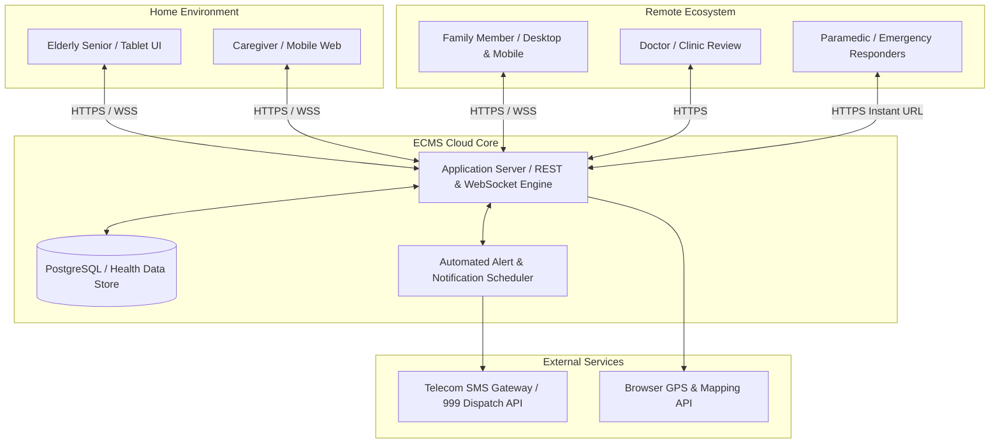

# Software Requirement Specification (SRS)
## Elderly Care Management System

---

**Standard:** IEEE Std 830-1998 / ISO/IEC/IEEE 29148:2018 Compliant  
**Student Name:** Farzana Sadia Takee  
**Student ID:** 2211175  
**Course:** Software Engineering / Requirements Engineering  
**Project Title:** Elderly Care Management System  
**Submission Date:** October 2026  
**Document Version:** 1.0 (Final Release)  

---

## Table of Contents
1. **Introduction**
   - 1.1 Purpose
   - 1.2 Document Conventions & Notation
   - 1.3 Intended Audience & Reading Suggestions
   - 1.4 Product Scope
   - 1.5 References
2. **Overall Description**
   - 2.1 Product Perspective & Context
   - 2.2 Product Functions Overview
   - 2.3 User Classes and Characteristics
   - 2.4 Operating Environment
   - 2.5 Design and Implementation Constraints
   - 2.6 User Documentation
   - 2.7 Assumptions and Dependencies
3. **External Interface Requirements**
   - 3.1 User Interfaces (UI)
   - 3.2 Hardware Interfaces
   - 3.3 Software Interfaces
   - 3.4 Communications Interfaces
4. **System Features & Detailed Functional Requirements**
   - 4.1 Module 1: Role-Based Authentication & Authorization (FR-AUTH)
   - 4.2 Module 2: Elderly Profile & Clinical Baseline Management (FR-PROF)
   - 4.3 Module 3: Medication Management & Adherence Tracker (FR-MED)
   - 4.4 Module 4: Doctor Appointment Scheduling & Clinic History (FR-APT)
   - 4.5 Module 5: Daily Care Schedule & ADL Routine (FR-CARE)
   - 4.6 Module 6: Caregiver Shift Handoff & Care Notes (FR-CG)
   - 4.7 Module 7: Instant Emergency SOS & Paramedic Health Brief (FR-SOS)
   - 4.8 Module 8: Central Family Dashboard & Live Audit Feed (FR-DASH)
5. **Non-Functional Requirements (NFRs / Quality Attributes)**
   - 5.1 Performance Requirements
   - 5.2 Safety & Clinical Safety Requirements
   - 5.3 Security Requirements & Health Data Protection
   - 5.4 Software Quality Attributes (Reliability, Usability, Maintainability, Portability)
6. **Requirements Traceability Matrix (RTM)**
7. **Appendix: Glossary of Terms & Acronyms**

---

## 1. Introduction

### 1.1 Purpose
This document constitutes the formal **Software Requirement Specification (SRS)** for the **Elderly Care Management System (ECMS)**. It provides a complete, unambiguous, and verifiable specification of all functional capabilities, external interfaces, performance thresholds, and non-functional quality constraints governing the development, deployment, and testing of the system.

### 1.2 Document Conventions & Notation
- Every requirement is uniquely numbered using the prefix **FR-** for Functional Requirements and **NFR-** for Non-Functional Requirements.
- The standard RFC 2119 keyword definitions apply throughout this document:
  - **SHALL / MUST:** Absolute, mandatory requirement for system compliance.
  - **SHOULD:** Strongly recommended requirement that may be omitted only with explicit justification.
  - **MAY:** Optional or future exploratory requirement.
- Priority levels are indicated as **High (H)**, **Medium (M)**, or **Low (L)**.

### 1.3 Intended Audience & Reading Suggestions
- **Academic Evaluators / Course Instructors:** Review the adherence to IEEE 830 standards, architectural traceability, and domain rigor.
- **System Architects & Software Developers:** Use Section 4 (System Features) and Section 3 (External Interfaces) to guide technical architecture and database schema implementation.
- **Quality Assurance Engineers:** Utilize the formal inputs, outputs, and validation rules in Section 4 along with Section 6 (Traceability Matrix) to construct test cases.

### 1.4 Product Scope
The **Elderly Care Management System** is a responsive, web-based digital care coordination platform. Its core objective is to prevent medication lapses, eliminate caregiver miscommunication, facilitate timely clinical consultations, and provide rapid emergency response for senior citizens living at home.
- **In-Scope:**
  - Multi-role authentication (Family Admin, Professional Caregiver, Elderly Senior, Doctor).
  - Elderly demographic, baseline vital, and critical drug allergy management.
  - Medication scheduling with visual pill cards, meal instructions, and 1-tap adherence logging.
  - Doctor appointment tracking, reminders, and historical consultation records.
  - Daily personal care checklists (Activities of Daily Living - ADLs).
  - Digital caregiver shift handoff documentation and end-of-shift notes.
  - Instant one-touch Emergency SOS speed dial (Ambulance, Hospital ER, Primary Doctor) with immediate Paramedic Health Brief and multi-channel SMS alert broadcast.
  - Real-time family dashboard with visual compliance gauges.
- **Out-of-Scope (Version 1.0):**
  - Direct video streaming tele-consultations (deferred to v2.0).
  - Physical IoT automated pill dispenser hardware robotics.
  - Hospital billing and insurance claim settlement processing.

### 1.5 References
1. **IEEE Std 830-1998:** IEEE Recommended Practice for Software Requirements Specifications.
2. **ISO/IEC/IEEE 29148:2018:** Systems and Software Engineering — Life Cycle Processes — Requirements Engineering.
3. **W3C WCAG 2.1:** Web Content Accessibility Guidelines (Level AA Standard for Senior Accessibility).
4. **Health Insurance Portability and Accountability Act (HIPAA) / GDPR:** Guidelines for Sensitive Personal Health Information (PHI) Security and Encryption.

---

## 2. Overall Description

### 2.1 Product Perspective & Context
The Elderly Care Management System operates as a modern cloud-hosted web application accessible across desktop web browsers, wall-mounted or bedside tablets, and mobile smartphones. It serves as the single source of truth connecting the home environment directly with remote family members and attending clinical providers.

### 2.2 Product Functions Overview
- **F-01 Identity & RBAC Management:** Secure multi-role access control with simplified senior pin-code authentication.
- **F-02 Clinical Profile & Allergy Registry:** High-visibility master record of medical history, blood group, and fatal drug allergies.
- **F-03 Medication Administration & Adherence Tracker:** Visual pill schedules, Before/After meal guidance, 1-tap taken/skipped logger, and overdue alerts.
- **F-04 Doctor Appointment Management:** Chamber directory, appointment scheduling, reminders, and historical consultation logs.
- **F-05 Activities of Daily Living (ADL) Care Plan:** Checklists for nutrition, hydration, hygiene, mobility, and vital signs monitoring.
- **F-06 Caregiver Shift Handoff & Care Notes:** Structured digital handoff reports, vital sign verification, and family debriefings.
- **F-07 Emergency SOS & Paramedic Medical Card:** Immediate 1-tap speed dialing for Ambulance/ER, live GPS pin sharing, and instant Paramedic Brief display.
- **F-08 Central Family Monitoring Console:** Real-time visibility into the day’s care progress, adherence scores, and vital sign logs.

### 2.3 User Classes and Characteristics

| User Class | Technical Literacy | Operating Context | Primary System Interactions |
| :--- | :--- | :--- | :--- |
| **Family Member (Admin)** | High | Office desktop, laptop, smartphone. | Full administrative configuration, medication scheduling, appointment booking, reviewing adherence logs, emergency monitoring. |
| **Professional Caregiver** | Moderate | Smartphone (Android/iOS) during active work shift. | Fast 1-tap marking of medication, checking off care routines, logging vitals (BP/sugar), submitting shift handoffs. |
| **Elderly Senior Citizen** | Low to Moderate | Home tablet (10-inch) mounted in living room or bedroom. | Viewing large visual daily schedule, reading medication reminders, triggering emergency SOS button. |
| **Doctor / Physician** | High | Clinic PC or tablet during 15-minute consultations. | Reviewing medication adherence history, inspecting vital trends, updating prescription notes. |
| **Paramedic / ER Triage** | High (Medical) | Emergency response vehicle or emergency triage room. | Reading high-contrast Paramedic Brief (blood type, penicillin allergy, chronic conditions, contact numbers). |

### 2.4 Operating Environment
- **Client Platforms:** 
  - Modern web browsers: Google Chrome 110+, Microsoft Edge 110+, Apple Safari 16+, Mozilla Firefox 112+.
  - Responsive viewports: Desktop (1920x1080, 1366x768), Tablet Landscape & Portrait (1024x768, 800x1280), Mobile (375x812, 412x915).
- **Server Platform:** Node.js (v18+ LTS) or Python (v3.11+) hosted in standard cloud container environment.
- **Database Engine:** Relational Database (PostgreSQL 14+ or MySQL 8.0+) with ACID transaction compliance.
- **Network Protocol:** Encrypted HTTPS over TLS 1.3; Secure WebSockets (`wss://`) for live dashboard push updates.

### 2.5 Design and Implementation Constraints
- **Accessibility Compliance:** The system MUST strictly comply with **WCAG 2.1 Level AA** standards. Body text for senior viewports shall not be smaller than 18px; touch targets must measure at least 48x48 CSS pixels; color contrast ratios must exceed 4.5:1.
- **Data Privacy & Security:** Sensitive health data (diagnoses, allergies, medication records) must be encrypted at rest using AES-256 and in transit using TLS 1.3.
- **Offline Resilience:** The application client must cache today’s active medication schedule locally in Browser Storage (IndexedDB / LocalStorage) to allow viewing even during intermittent Wi-Fi drops.

### 2.6 User Documentation & Onboarding
- The system shall include an interactive "Senior Quick Guide" featuring large visual illustrations.
- A "Caregiver 2-Minute Quick Reference Card" shall be printable directly from the administrative portal.

### 2.7 Assumptions and Dependencies
- **Network Availability:** While offline caching supports viewing, real-time family synchronization and SMS alerts depend on standard 4G/Wi-Fi internet access.
- **Emergency Hardware Dialing:** Emergency speed-dial links rely on the standard `tel:` protocol supported by mobile devices and phone-enabled tablets.

---

## 3. External Interface Requirements

### 3.1 User Interfaces (UI)
The user interface follows the design tokens established in the approved UI/UX specification:
- **Color System:**
  - Primary Brand: Teal (`#0D9488`, Dark `#0F766E`, Light `#CCFBF1`) representing calm, trustworthy clinical care.
  - Emergency SOS: Vivid Rose / Crimson (`#E11D48`, Dark `#881337`, Light `#FFE4E6`) for rapid recognition.
  - Neutral Backgrounds: Slate (`#F8FAFC`, `#F1F5F9`, `#1E293B`).
  - Status Indicators: Emerald Green (`#059669`) for Taken/Completed; Amber (`#F59E0B`) for Pending/Skipped.
- **Typography:** Modern, highly legible sans-serif fonts (`Plus Jakarta Sans` or `Inter`). Font sizes for senior viewports range from 18px (body) to 28px (headings).
- **Touch Ergonomics:** High affordance cards with elevated shadows, prominent rounded buttons, and zero nested sub-menus.

### 3.2 Hardware Interfaces
- **Tablet / Touchscreen Support:** The application layout must adapt seamlessly to 10-inch Android or iPad tablets mounted at home bedside tables.
- **Direct Dialing Hardware:** Mobile devices must support telephony hardware interfaces triggered via `tel:+880...` hyperlinks.

### 3.3 Software Interfaces
- **SMS Gateway API:** Integration with an external SMS gateway (e.g., Twilio, Infobip, or national telecom provider) to send high-priority SMS alerts for missed medication escalations and emergency SOS broadcasts.
- **Geolocation API:** Standard W3C HTML5 Geolocation API (`navigator.geolocation`) to capture GPS latitude/longitude during emergency SOS activation.
- **Web Push Notification Service:** W3C Push API / Apple APNs to deliver lock-screen reminder banners.

### 3.4 Communications Interfaces
- **HTTPS:** All client-server communication must occur over port 443 with TLS 1.3 encryption.
- **WebSockets (WSS):** Persistent duplex connection over `wss://` to push immediate medication dispense confirmations and vital alerts to connected family dashboards without manual page refreshing.
- **Data Format:** Standard RESTful JSON format for all API payloads.

---

## 4. System Features & Detailed Functional Requirements

### 4.1 Module 1: Role-Based Authentication & Authorization (FR-AUTH)

#### FR-AUTH-01: Multi-Role Account Authentication
- **Description:** The system shall authenticate users into one of four distinct roles: Family Admin, Professional Caregiver, Elderly Senior, or Doctor.
- **Inputs:** Username/Email and Password for Family Admin/Doctor; 4-digit Quick PIN for Caregiver and Senior.
- **Processing Logic:**
  1. System checks user identifier in `USERS` database table.
  2. For passwords, system verifies against stored `bcrypt` hash.
  3. For Quick PINs, system validates against encrypted profile PIN.
  4. System issues an encrypted JWT (JSON Web Token) with claims: `userId`, `role`, `elderlyId`, `exp`.
- **Outputs:** Authentication success redirects user to role dashboard; failure displays descriptive error message.
- **Error Handling:** Account locks after 5 consecutive failed attempts for 15 minutes.

#### FR-AUTH-02: Role-Based Access Control (RBAC) Enforcement
- **Description:** The system shall restrict access to administrative functions based on user role.
- **Business Rules:**
  - Family Admin: Full Read/Write/Delete rights on all modules.
  - Caregiver: Read rights on schedules; Write rights on dispensation logs, vital logs, and shift notes; No right to delete or alter prescription schedules.
  - Senior: Read rights on today's schedule; 1-tap dispense confirm; Emergency SOS trigger.
  - Doctor: Read rights on medical baseline, adherence history, and vital trends; Write rights on consultation notes.

#### FR-AUTH-03: Session Management & Inactivity Timeout
- **Description:** The system shall automatically terminate inactive administrative sessions after 30 minutes of inactivity while maintaining persistent active mode on designated home tablets.

---

### 4.2 Module 2: Elderly Profile & Clinical Baseline Management (FR-PROF)

#### FR-PROF-01: Elderly Profile Creation & Modification
- **Description:** The system shall maintain a master profile for each registered elderly individual.
- **Inputs:** Full Name, Date of Birth, Gender, Blood Group, Home Address, GPS Latitude/Longitude, National ID, Primary Emergency Phone.
- **Processing Logic:** System validates date of birth (must be >= 55 years for senior care), ensures blood group belongs to standard 8 types (A+, A-, B+, B-, AB+, AB-, O+, O-), and commits to database.
- **Outputs:** Profile summary card visible on dashboard and emergency screens.

#### FR-PROF-02: Critical Drug Allergy & Medical Baseline Registry
- **Description:** The system shall record chronic ailments (e.g., Type 2 Diabetes, Hypertension) and explicitly highlight critical drug allergies (e.g., Penicillin, Sulfa drugs).
- **Processing Logic:** Allergies are flagged as `HIGH_CRITICALITY` and permanently rendered in bold red banners across the profile, medication creation form, and emergency brief.

#### FR-PROF-03: Medical Document Archival
- **Description:** The system shall allow uploading and viewing PDF/JPEG copies of hospital discharge certificates, diagnostic test results, and ECG scans (max 10MB per file).

---

### 4.3 Module 3: Medication Management & Adherence Tracker (FR-MED)

#### FR-MED-01: Medication Schedule Creation
- **Description:** The system shall enable the Family Admin to configure detailed medication schedules.
- **Inputs:** Medicine Brand Name (e.g., "Losartan"), Generic Name ("Losartan Potassium"), Dosage Strength ("50mg"), Dosage Form ("Tablet", "Capsule", "Syrup", "Drop"), Quantity ("1 tablet"), Frequency ("Once Daily", "Twice Daily", "Thrice Daily"), Scheduled Time(s) (HH:MM), Meal Relation ("Before Meal", "After Meal", "With Meal", "Empty Stomach"), Prescribing Doctor, Start Date, End Date.
- **Outputs:** Active medication record added to schedule calendar.

#### FR-MED-02: Visual Pill Identification Cards
- **Description:** The system shall display distinct visual iconography for each scheduled medication, including pill shape (Round, Oval, Capsule, Liquid bottle) and color (White, Blue, Yellow, Pink), enabling elderly users and caregivers to recognize medications physically without reading fine text.

#### FR-MED-03: 1-Tap Medication Dispensation Logging
- **Description:** The system shall allow the Caregiver, Senior, or Family member to record medication intake with a single click.
- **Inputs:** Tap on "Mark as Taken" button; optional note field.
- **Processing Logic:** System registers exact server timestamp (`actual_time`), logs `logged_by_user_id`, and sets status to `TAKEN`.
- **Outputs:** Green checkmark displayed; adherence progress bar updates immediately; WebSocket notification pushed to Family Admin.

#### FR-MED-04: Medication Skipped / Refused Logging
- **Description:** If a scheduled medication is not taken, the user shall mark it as skipped and select a mandatory reason.
- **Inputs:** Reason dropdown: `Patient Refused`, `Patient Vomited/Nauseous`, `Fasting for Blood Test`, `Medication Out of Stock`, `Doctor Advised Pause`.
- **Outputs:** Status updated to `SKIPPED` (Amber badge); instant alert dispatched to Family Admin.

#### FR-MED-05: Automated Missed-Dose Escalation Engine
- **Description:** The system shall monitor all scheduled doses. If a scheduled medication remains in `PENDING` status for more than 30 minutes past its scheduled time, the system shall trigger an automated escalation event.
- **Processing Logic:** Background scheduler flags dose as `OVERDUE`, dispatches an automated SMS/Push notification to the Family Admin: *"ALERT: [Medicine Name] for [Elderly Name] was scheduled for [Time] and has not been confirmed."*

---

### 4.4 Module 4: Doctor Appointment Scheduling & Clinic History (FR-APT)

#### FR-APT-01: Appointment Booking & Clinic Registration
- **Description:** The system shall allow scheduling clinical appointments with doctors.
- **Inputs:** Doctor Name, Medical Specialty (e.g., "Cardiologist", "Neurologist"), Hospital/Clinic Name, Chamber/Room Number, Appointment Date & Time, Patient Serial/Token Number, Reason for Consultation.
- **Outputs:** Appointment card listed under "Upcoming Appointments" with countdown badge.

#### FR-APT-02: Automated Appointment Reminders
- **Description:** The system shall send automated reminders to both Family Admin and Caregiver at two intervals: 24 hours prior to appointment and 2 hours prior to appointment.

#### FR-APT-03: Post-Visit Documentation & History Archival
- **Description:** Upon completion of a medical visit, the system shall allow the user to mark the appointment as `Completed`, upload the newly issued prescription photo, and record the doctor’s recommended follow-up date.

---

### 4.5 Module 5: Daily Care Schedule & ADL Routine (FR-CARE)

#### FR-CARE-01: Daily Activities of Daily Living (ADL) Checklist
- **Description:** The system shall generate a structured daily checklist for non-medicinal health routines: Breakfast, Morning Walk, Hydration Target (1.5L - 2.0L), Afternoon Bath, Evening Rest, Dinner.
- **Outputs:** Interactive checklist allowing caregivers to check off completed routines.

#### FR-CARE-02: Vital Signs Recording & Boundary Checks
- **Description:** The system shall record daily physiological vitals measured by the caregiver or senior.
- **Inputs:** Systolic Blood Pressure (mmHg), Diastolic Blood Pressure (mmHg), Heart Rate / Pulse (bpm), Blood Sugar (mmol/L), Body Temperature (°F).
- **Processing Logic:** System compares entered values against clinical reference boundaries:
  - Systolic BP > 140 or < 90 -> Warning: Elevated/Low BP.
  - Blood Glucose > 11.1 or < 4.0 -> Warning: Hyper/Hypoglycemia.
- **Outputs:** Vital record saved; abnormal readings highlight in red and alert Family Admin.

---

### 4.6 Module 6: Caregiver Shift Handoff & Care Notes (FR-CG)

#### FR-CG-01: End-of-Shift Summary Generation
- **Description:** At the conclusion of a caregiver’s shift, the system shall auto-aggregate all medications dispensed, tasks completed, and vitals logged during that shift into an automated Handoff Report.

#### FR-CG-02: Shift Notes & Handoff Signature Submission
- **Description:** The outgoing caregiver shall enter free-text qualitative notes (e.g., physical mood, appetite, mobility difficulties) and record the name of the individual accepting handoff responsibility (e.g., incoming night caregiver or returning family member).
- **Outputs:** Signed shift record permanently archived; summary sent to Family Dashboard.

---

### 4.7 Module 7: Instant Emergency SOS & Paramedic Health Brief (FR-SOS)

#### FR-SOS-01: Rapid Emergency SOS Console Launch
- **Description:** The system shall provide an omnipresent, high-contrast, red "EMERGENCY SOS" button on every screen header.
- **Processing Logic:** When tapped, the system shall navigate to the Emergency Console in less than 500 milliseconds without requesting secondary confirmations or passwords.

#### FR-SOS-02: One-Touch Emergency Speed Dialing
- **Description:** The Emergency Console shall display three prominent, high-contrast speed-dial triggers:
  1. 🚑 National Ambulance Dispatch (`tel:999` or `tel:199`)
  2. 🏥 Hospital ER Emergency Desk (`tel:10616` / Square Hospital ER)
  3. 👨‍⚕️ Primary Attending Physician Direct Line
- **Outputs:** Single tap initiates immediate hardware telephony call.

#### FR-SOS-03: Paramedic Critical Health Brief Display
- **Description:** The Emergency Console shall prominently render the Paramedic Critical Health Brief in high-contrast text:
  - Patient Full Name and Age (e.g., Abdul Rahman Chowdhury, 76 Yrs).
  - Blood Group (e.g., B Positive - B+).
  - **CRITICAL ALLERGIES:** Bold, red highlighted text: **"PENICILLIN (Causes Anaphylaxis)"**.
  - Key Chronic Conditions (Type 2 Diabetes, Hypertension, Coronary Stent).
  - Exact Home Physical Address and GPS Latitude/Longitude Coordinates.

#### FR-SOS-04: One-Tap Broadcast SMS Alert to Family Contacts
- **Description:** When the user taps "TRIGGER BROADCAST SMS TO ALL FAMILY", the system shall immediately dispatch an emergency distress SMS via the SMS Gateway to all registered emergency family contacts containing the senior’s name, emergency trigger time, and Google Maps live GPS link.

---

### 4.8 Module 8: Central Family Dashboard & Live Audit Feed (FR-DASH)

#### FR-DASH-01: Consolidated Daily Care Status Card
- **Description:** The Family Dashboard shall display high-level status indicators summarizing:
  - Today's Medication Adherence Progress (e.g., "3 of 4 Doses Taken - 75%").
  - Today's Care Routine Progress (e.g., "5 of 6 Tasks Completed").
  - Latest Recorded Vitals (BP, Sugar, Pulse) with time elapsed.
  - Active Caregiver on Duty (Name, Phone, Shift status).

#### FR-DASH-02: Real-Time Live Activity Feed
- **Description:** The dashboard shall render a chronological, time-stamped activity feed updating in real-time via WebSockets as events occur (e.g., "13:05 - Rahima marked Metformin 500mg as TAKEN").

---

## 5. Non-Functional Requirements (NFRs / Quality Attributes)

### 5.1 Performance Requirements
- **NFR-PERF-01 (Page Load Latency):** The initial load time of the web application shall not exceed **1.5 seconds** over a standard 4G broadband connection.
- **NFR-PERF-02 (Emergency Console Latency):** The Emergency SOS console and Paramedic Brief screen MUST render completely within **500 milliseconds** of clicking the SOS button.
- **NFR-PERF-03 (Real-Time Notification Speed):** WebSocket push updates from the caregiver's device to the family dashboard shall propagate within **2.0 seconds**.
- **NFR-PERF-04 (Emergency SMS Dispatch):** Emergency broadcast SMS messages must be handed off to the SMS gateway provider within **3.0 seconds** of user trigger.
- **NFR-PERF-05 (Concurrency):** The backend server shall sustain at least **500 concurrent active user sessions** without degradation in response times exceeding 300ms for API endpoints.

### 5.2 Safety & Clinical Safety Requirements
- **NFR-SAFE-01 (Duplicate Dispensation Lock):** Once a scheduled medication dose is marked as `TAKEN`, the system shall lock the dispensation button to prevent accidental double-dispensation or double-logging within the same time window.
- **NFR-SAFE-02 (Fatal Allergy Prominence):** Drug allergies classified as life-threatening (e.g., Penicillin) shall never be truncated, hidden under accordions, or obscured by popups on any emergency or profile viewport.
- **NFR-SAFE-03 (Offline Emergency Availability):** Critical emergency contacts and the Paramedic Health Brief shall be stored in client-side persistent storage (IndexedDB) so they remain viewable even if the home internet connection disconnects.

### 5.3 Security Requirements & Health Data Protection
- **NFR-SEC-01 (Authentication Security):** All user passwords shall be hashed using `bcrypt` with a minimum work factor of 12. Plaintext passwords shall never be logged or stored.
- **NFR-SEC-02 (Data Encryption at Rest):** All sensitive personal health records (medical history, doctor notes, allergies) shall be encrypted at rest in the database using industry-standard **AES-256** encryption.
- **NFR-SEC-03 (Data Encryption in Transit):** All communications between clients and servers must be encrypted using **TLS 1.3**. Unencrypted HTTP requests shall be automatically redirected to HTTPS.
- **NFR-SEC-04 (Immutable Audit Trail):** The system shall maintain an immutable, append-only audit log recording every medication status change, profile update, and emergency activation, capturing User ID, IP Address, Timestamp, and Action.
- **NFR-SEC-05 (Cross-Site Scripting & Injection Prevention):** All user input fields must be sanitized and parameterized to prevent SQL Injection and Cross-Site Scripting (XSS) attacks.

### 5.4 Software Quality Attributes

#### 5.4.1 Reliability & Availability
- **NFR-REL-01 (System Availability):** The system shall guarantee **99.9% uptime** (less than 8.76 hours of unplanned downtime per year).
- **NFR-REL-02 (Automated Cloud Backups):** The database shall undergo automated encrypted snapshots every 24 hours, with transaction log archiving enabling point-in-time recovery with a Recovery Point Objective (RPO) of < 1 hour.
- **NFR-REL-03 (Mean Time to Recover - MTTR):** In the event of server failure, automated container orchestrators shall restart the service within an MTTR of **< 5 minutes**.

#### 5.4.2 Usability & Senior Accessibility
- **NFR-USA-01 (WCAG 2.1 AA Compliance):** The user interface shall comply with Web Content Accessibility Guidelines (WCAG) 2.1 Level AA.
- **NFR-USA-02 (Touch Affordance):** Interactive buttons and touch targets on tablet and mobile viewports shall have a minimum clickable area of **48 x 48 CSS pixels** with adequate spacing (minimum 8px) to prevent accidental taps by users with motor tremors.
- **NFR-USA-03 (Contrast Ratio):** All text elements shall achieve a minimum contrast ratio of **4.5:1** against their background; large headers and emergency buttons shall exceed **7.0:1**.

#### 5.4.3 Maintainability & Portability
- **NFR-MAINT-01 (Modular Architecture):** The codebase shall adhere to clean modular separation (Presentation, Business Logic, Data Access layers) with comprehensive documentation enabling independent maintenance.
- **NFR-PORT-01 (Cross-Browser Compatibility):** The web application shall render identically and function without script errors across Chrome, Edge, Safari, and Firefox on Windows, macOS, Android, and iOS.

---

## 6. Requirements Traceability Matrix (RTM)

The Requirements Traceability Matrix maps each Elicited User Need (UN) to its corresponding Analysis Use Case (UC), SRS Functional Requirement (FR), and Quality Verification Method:

| User Need ID | User Need Description | Use Case ID | SRS Functional Requirement ID | Verification Method |
| :--- | :--- | :--- | :--- | :--- |
| **UN-01** | Unified elderly medical profile & allergy registry | UC-02 | FR-PROF-01, FR-PROF-02, FR-PROF-03 | Inspection & Test |
| **UN-02** | Visual medication schedule with meal instructions | UC-03 | FR-MED-01, FR-MED-02 | Demonstration & Test |
| **UN-03** | Automated alerts for overdue/missed doses | UC-04 | FR-MED-05, FR-DASH-02 | Automated Unit & Integration Test |
| **UN-04** | 1-Tap quick dispensation logging for caregivers | UC-04 | FR-MED-03, FR-MED-04 | Demonstration & User Test |
| **UN-05** | Doctor appointment booking & reminders | UC-05 | FR-APT-01, FR-APT-02, FR-APT-03 | System Test |
| **UN-06** | Daily routine & ADL checklist with vitals logging | UC-06 | FR-CARE-01, FR-CARE-02 | Test & Inspection |
| **UN-07** | Standardized caregiver shift handoff & notes | UC-07 | FR-CG-01, FR-CG-02 | Demonstration & Test |
| **UN-08** | Instant emergency speed dials & paramedic brief | UC-08, UC-09 | FR-SOS-01, FR-SOS-02, FR-SOS-03, FR-SOS-04 | Performance & Field Safety Test |
| **UN-09** | Accessible senior UI (large text, high contrast) | All UIs | NFR-USA-01, NFR-USA-02, NFR-USA-03 | Accessibility Audit & User Test |
| **UN-10** | Role-based authentication & data security | UC-01 | FR-AUTH-01, FR-AUTH-02, NFR-SEC-01 to 04 | Security & Penetration Test |

*Verification Methods Definition:*
- **Test (T):** Quantitative verification by executing predefined test cases against software inputs and outputs.
- **Demonstration (D):** Qualitative verification observing system behavior during end-to-end user workflows.
- **Inspection (I):** Visual and manual examination of code, schemas, and UI layout against specifications.
- **Analysis (A):** Mathematical or theoretical verification of timing, concurrency, and security protocols.

---

## 7. Appendix: Glossary of Terms & Acronyms

- **ADL (Activities of Daily Living):** Basic everyday personal care tasks necessary for fundamental functioning, including eating, bathing, mobility, and hydration.
- **Bcrypt:** A password-hashing function designed by Niels Provos and David Mazières based on the Blowfish cipher.
- **EHR (Electronic Health Record):** Digital systematized collection of patient health information.
- **HIPAA:** Health Insurance Portability and Accountability Act; US federal standard governing privacy and security of personal health data.
- **JWT (JSON Web Token):** Compact, URL-safe means of representing claims to be transferred between two parties in web authorization.
- **MoSCoW:** Prioritization method used in software engineering: Must Have, Should Have, Could Have, and Won't Have.
- **Paramedic Health Brief:** A specialized, high-urgency clinical summary displaying blood group, critical drug allergies, and major medical diagnoses for emergency first responders.
- **RBAC (Role-Based Access Control):** Security mechanism restricting system access based on the authorized roles of verified users.
- **RTM (Requirements Traceability Matrix):** A grid linking customer requirements to system specifications, design components, and test artifacts.
- **SOS:** International maritime and emergency distress signal, used colloquially for urgent emergency dispatch features.
- **SRS (Software Requirement Specification):** Complete formal description of the behavior of a software system to be developed.
- **WCAG (Web Content Accessibility Guidelines):** Internationally recognized standards published by the W3C for digital web accessibility.
- **WSS (WebSocket Secure):** Encrypted full-duplex communication protocol over a single TCP connection.
